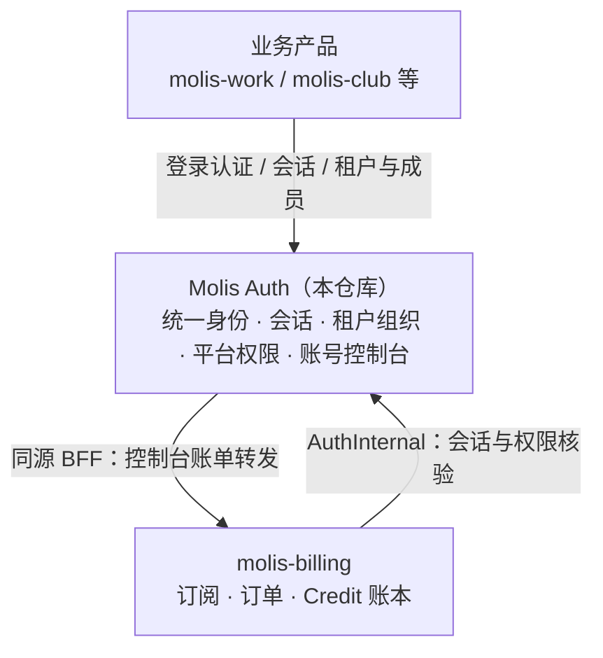

# Molis Auth

Molis 生态的**统一身份与组织底座**，基于 Cloudflare Worker（Rust/WASM）、D1、Static Assets 与 Vue 3 构建。

## 在产品矩阵中的位置



- **对业务产品（Work / Club 等）**：统一承载注册登录、产品独立会话、个人资料、租户与成员关系，各业务端不再自建账号体系。
- **对计费服务（molis-billing）**：Auth 管“你是谁、你在哪个团队、有什么角色”，Billing 管“钱、套餐和 Credit”；Auth 通过私有 `AuthInternal` 桥接为其提供实时鉴权，并在控制台以同源 BFF 转发账单请求。
- **对终端用户与平台管理员**：直接提供无浏览器 Token 暴露的登录页、个人与团队管理控制台、平台治理后台。

## 模块划分

### 后端模块（`worker/rust/src/`）

| 模块 | 做什么 |
| --- | --- |
| `auth` | 注册、一步登录（密码 / 验证码 / Google / GitHub）、会话令牌轮换与登出、管理访问控制 |
| `account` | 个人资料、头像、邮箱/手机绑定与换绑、密码与二次安全验证 |
| `team` | 租户创建、成员角色（`OWNER` / `ADMIN` / `MEMBER`）、邀请与所有权转移 |
| `platform` | 应用与客户端登记、用户启停、平台细粒度能力权限与租户创建策略 |
| `audit` | 账号安全与平台管理审计记录及分页查询 |
| `delivery` | 邮件与短信验证码投递（本地 Mock / 阿里云） |
| `web` | 控制台同源 BFF（`/api/account/*`）、HttpOnly Cookie 会话、壳页渲染与 Billing 转发 |
| `internal` | 面向内部服务的私有鉴权桥接（`AuthInternal` / `/internal/v1/*`） |
| `core` | HTTP、D1 原子存储、加密签名、契约校验与分层定时清理等基础设施 |

### 前端与契约

| 目录 | 做什么 |
| --- | --- |
| `web/` | Vue 3 账号登录与控制台前端（登录入口、个人中心、安全设置、团队管理、账单面板、平台治理） |
| `contracts/` | `unified-account` 跨产品接口契约，供 Auth 与各业务端保持协议同步 |
| `worker/migrations/` | 单基线 D1 数据结构（`0001_auth_baseline.sql`） |

## 本地开发与验证

需要 Node.js 22.18+ 与 npm。

```sh
cp secrets.example/dev.properties secrets/dev.properties
npm run setup
npm start -- --env dev          # 本地启动 http://127.0.0.1:8787
```

常用检查：

```sh
npm run format:check && npm run clippy && npm test
npm run build
```

| 环境 | 域名 | Worker | D1 |
| --- | --- | --- | --- |
| `dev` | `http://127.0.0.1:8787` | `molis-auth-local` | `auth-local` |
| `test` | `https://auth.test.molis.ai` | `molis-auth-test` | `molis-auth-test` |
| `prod` | `https://auth.molis.ai` | `molis-auth-production` | `molis-auth-prod` |

## 延伸文档

- [系统架构](docs/architecture.md) · [三环境执行方案](docs/environment-unification.md) · [Cloudflare 部署](docs/cloudflare-deployment.md)
- [统一账号接入手册](docs/unified-account/integration-guide.md) · [API 契约](docs/unified-account/api-contracts.md) · [Account-Billing BFF](docs/account-billing-bff.md)
