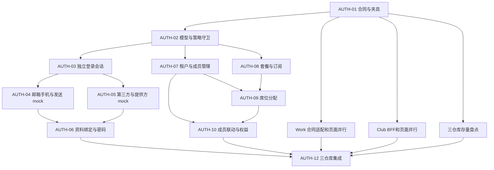

# Molis 统一账号开发任务

状态：2026-11-05，AUTH-01 至 AUTH-10、WORK-01 至 WORK-09、CLUB-01 至 CLUB-09 已实现并完成各阶段本地隔离验证。AUTH-11 的盘点工具、方案和合成演练见第 24 节；WORK-09 / CLUB-09 的旧入口切换与联合证据见第 25 节。按本轮范围未读取真实数据，实际存量与 D-09 凭据接续仍待确认，方案见[账号迁移](account-migration-plan.md)。AUTH-12 已完成[验收矩阵](acceptance-matrix.md)、[版本与交付记录](delivery.md)汇总，已知问题及真实环境待办见该记录；没有将其标为全部上线完成。本文将[需求](requirements.md)和[接口合同](api-contracts.md)拆为可独立评审的仓库任务；P0 至 P5 的阶段定义沿用[实施计划](implementation-plan.md)。任务表列的是各任务的完成标准；未列出的业务验收尚未执行。短信、邮件与 Google/GitHub 按 C-36 至 C-38 使用本地/隔离环境中的外部 mock，中央身份、成员、订阅、席位和权益必须真实实现。

接续当前阶段按[实施计划第 11 节](implementation-plan.md#11-后续执行指引)执行；T-01 至 T-07 的状态与完成标准统一在[交付台账](delivery.md#6-剩余待办与依赖顺序)维护。下面的 AUTH/WORK/CLUB 任务表及分阶段证据继续保留，不因收尾重新编号。

## 1 顺序与并行边界

依赖分为“合同已冻结即可开工”和“上游已实现才能验收”。表中的前置任务指后者；两产品可在对应 API Schema 和夹具冻结后并行开发，不必等 Auth 全部完成。但使用整套假 Auth/商业返回值的页面，只能算界面开发，不能算任务集成验收通过。

下图展示主链路，具体完成前置以各仓库任务表为准。



| 批次 | 优先交付 | 可并行 | 本批退出标准 |
| --- | --- | --- | --- |
| B0 合同和基础 | AUTH-01/02、WORK-01、CLUB-01，启动 AUTH-11/CLUB-08 盘点 | 环境登记、客户端白名单、隔离夹具、页面结构 | DTO/错误/权限/状态机能被三端同一份样本验证；旧路由旁路用例已列入 |
| B1 账号闭环 | AUTH-03 至 AUTH-06；WORK-02 至 WORK-05；CLUB-02 至 CLUB-04 | 邮箱/手机和 Google/GitHub 可并行，均用外部 mock | 两端完整注册、登录、绑定、资料、改密、找回、重启和退出；无额外 Auth 确认页 |
| B2 租户成员 | AUTH-07；WORK-06、CLUB-05 | 可与 B1 后半并行 | 平台创建/停用恢复、定向邀请、角色、交接；离租户联动在 B3 收口 |
| B3 商业管理 | AUTH-08 至 AUTH-10；WORK-07/08、CLUB-06/07 | 套餐模型可先于成员界面，页面按合同并行 | 实际订阅/库存/分配和真实权益判定；容量与成员变化原子一致 |
| B4 内部集成和迁移演练 | AUTH-11/12、WORK-09、CLUB-09 | 脱敏/合成迁移样本、两端 E2E、拒绝场景 | mock 阶段验收矩阵和迁移待办明确；不宣称已完成真实外部服务验证 |
| B5 真实外部接入 | X-01 至 X-03 | 不阻塞 B0 至 B4 的独立开发 | 实际发送、官方 OAuth 与正式回调验证后，才评估对应真实用户发布 |

## 2 Auth 仓库

后端遵循现有 Rust/WASM → 领域模块 → D1 路径。通用 Schema、协议夹具与错误定义由 Auth 维护；浏览器 SDK 不能被直接搬成服务器/原生凭据存储。新增商业模块通过公开领域函数与成员服务协调；现有 `auth_grant` 继续只表示认证授权。

| 任务 | 交付范围 | 完成前置 | 逐项验收与需求编号 |
| --- | --- | --- | --- |
| AUTH-01 合同和可执行样本 | 将 API-01 至 API-09 固化为 OpenAPI 3.1、JSON Schema、purpose/method 联合类型、权限矩阵、幂等/版本和错误表；提供脱敏正反样本及 Rust/TS 校验入口 | 无；由三仓库共同评审调用合同 | 相同样本被三端同样接受/拒绝；无客户端自报 actor；核对本文件全部 UAS 映射；工程 TTL/限制有明确默认值而非散落常量。UAS-01、11、26 |
| AUTH-02 模型 迁移与客户端策略 | 独立登录、身份证明、租户纳管状态、平台权限、订阅/席位表结构和索引；Work/Club policy profile、环境/回调登记；统一 v1/v2 权限守卫 | AUTH-01 | 迁移不清库、不提高邮箱可信度；新客户端不能走旧 spaces 创建/归档/提权旁路，旧 TEAM 不自动纳管；租户角色不能取得平台权限。UAS-11、16、28、30、34、40 |
| AUTH-03 登录会话与撤销（已实现） | API-04；独立 30/90 天、服务端活动、Token 轮换、当前/全局撤销及撤销边界；撤销请求响应丢失与过期 access 的处理 | AUTH-02 | 主动活动仅更新本次登录闲置时间；后台不续活；跨产品/设备互不续期；全局退出后旧 PENDING 事务、授权码、迟到刷新不能建会话。UAS-09、10、11、26、38 |
| AUTH-04 邮箱手机与投递端口（已实现） | API-02 邮箱密码、邮箱验证注册、+86 首登开户、找回挑战；SmsSender/MailSender 及受控 mock 收件设施，限流和消费状态 | AUTH-03 | 两客户端无需 Auth 确认页；未验证不开新邮箱账号；手机号并发首登只有一个用户；错误/过期/重放/用途串用/重发上限被拒；发送 mock 不代替验证。UAS-01 至 UAS-04、26、28、39 |
| AUTH-05 Google GitHub 及提供方 mock（已实现） | 两提供方适配、稳定 subject 映射、一次性 browser start、完整回调、无邮箱身份、成功/取消/失败模拟 | AUTH-03 | 两端真实发起→模拟提供方→受保护回调→Auth 换码；错误 state/浏览器绑定/客户端/环境、旧回调均拒；不依邮箱自动关联、不接受前端 subject。UAS-05、11、28、40 |
| AUTH-06 资料 登录方式与密码（已实现） | API-03；图片清洗、任一方式再次验证、绑定/换绑/解绑、无密码账号设置、改密与找回完成 | AUTH-04、AUTH-05 | 占用冲突不合并；丢失一种方式可用另一种换绑；最后可用方式不被移除；密码更新与 C-39 撤销原子提交，客户端不能自选保留会话。UAS-03、06 至 UAS-08、26、33、41 |
| AUTH-07 租户与管理生命周期（已实现） | API-05 创建/资料/平台启停、查询、邀请及确认、角色任命、所有权交接；离开/移除的原子联动已由 AUTH-10 收口 | AUTH-02、AUTH-03 | 普通用户不能创建；只有目标身份能接受邀请；交接保持唯一 OWNER，原 OWNER 按 C-40 变 MEMBER 且席位不动；停用后拒绝租户访问，无永久删除。UAS-12、13、14、16、34、35、42 |
| AUTH-08 套餐和订阅生命周期（已实现，容量联验已通过） | API-06 功能目录、不可变套餐版本、平台开通/变更/续期、有效期/启停、分类型数量与审计；隔离功能项配置 | AUTH-02；租户归属依 AUTH-07 | 个人订阅归本人；平台权限与租户管理权限分开；明确起止时间，到期不删记录，停用不顺延；没有支付/订单捷径；容量变更接口最终与 AUTH-09 联合验收。UAS-17、19、20、22、32、36、37 |
| AUTH-09 席位库存与原子分配（已实现） | API-06 分配、回收、换绑和历史；各订阅/类型容量锁与版本守卫；与订阅数量/类型变更共用一致性检查 | AUTH-07、AUTH-08 | 最后一个库存并发分配只成功一个；到期保留分配仍占库存；未先回收不能减量或删换类型；换绑原子完成；续期不复活历史。UAS-18 至 UAS-22、36、37 |
| AUTH-10 成员联动与权益服务（已实现） | 完成离开/移除与全部相关席位释放事务；API-07 当前用户权益查询、来源并集、版本推进、最新事实复核 | AUTH-07 至 AUTH-09 | 失败或重试不留下“成员已移除但席位仍占用”；重新加入不复活分配；个人/租户来源并集正确；停用、移除、回收后立即重查无旧授权。UAS-14、15（夹具）、17 至 UAS-24、33、35 |
| AUTH-11 存量盘点与中央切换方案（工具/方案/合成演练完成，实际盘点待授权） | 只读盘点部署未知项、密码格式、验证状态、稳定第三方标识、旧 TEAM；账号接续/纳管与回退方案；仅撤销目标产品会话；备份及隔离恢复 | 盘点从 AUTH-01 并行；执行演练依 AUTH-06/10 和 D-09 方案 | 合成副本上重复执行不重复建号；同邮箱不接管；其他产品旧会话仍有效；不能证明归属的记录保留并列待处理。真实存量覆盖另验。UAS-27 至 UAS-30 |
| AUTH-12 跨仓库集成与交付记录 | 汇总联调矩阵、固定版本与环境、失败用例、迁移演练和 mock 标记；修订现有接入文档/SDK示例/管理说明 | AUTH-06、AUTH-10、AUTH-11；WORK-09、CLUB-09 提供对应证据 | 以同一 Auth/D1 验证两产品读取一致；所有本期 UAS 有证据或明确待办；外部真实验证与内部完成状态分开，未执行项不标通过。UAS-01 至 UAS-42 |

AUTH-07 的成员退出/移除接口已由 AUTH-10 开放，与全部当前席位释放原子提交。AUTH-08 容量/类型变更、AUTH-09 分配/回收/换绑与 AUTH-10 成员联动共用当前分配和版本约束；无需前端补偿。API-07 按当前个人订阅和当前租户席位真实判定，产品页面仍按下述任务接入。

## 3 molis-work 仓库

建议将账号协调放入新的 `horizontal/account`，公开合同归 `packages/contracts`，Host 装配和保护入口，工作台负责页面，桌面负责系统浏览器和回跳。具体目录和包登记在 WORK-01 依仓库边界确认；不把整条 personal 分支合入，也不把账号功能伪装成某个插件专用 Host 服务。

| 任务 | 交付范围 | 完成前置 | 逐项验收与需求编号 |
| --- | --- | --- | --- |
| WORK-01 合同适配与包边界 | API-08 DTO/错误映射、认证窄入口及非凭据管理动作合同、账号服务 owner 和 Host 注入、环境/回调配置；盘点 personal 实际使用与旧凭据，不碰真实 Home | AUTH-01 合同；结构评审 | 身份/Scope/本地 actor 分开；没有浏览器 Token 或通用任意 URL 代理；新包 README、owner 与 SSOT 方案齐全。UAS-01、11、25、26、28、31 |
| WORK-02 Host 会话与凭据生命周期 | 单 Host 共享登录、SecretStore 持久化、30/90 天活动、刷新单飞、epoch、重启恢复、两种退出与离线撤销状态 | WORK-01、AUTH-03 | 浏览器与桌面共享当前登录，其他独立登录不误退；断网只保留提示缓存；迟到响应、取消、重启不能复活已退出会话；本地功能继续可用。UAS-09 至 UAS-11、25、26、38 |
| WORK-03 邮箱与手机页面 | 工作台内注册、邮箱验证、密码登录、+86 自动注册提示、重发/失败/找回流程；认证窄入口不记录凭据 | WORK-02、AUTH-04；找回完成依 AUTH-06 | 原产品完成，无 Auth 确认页；mock 投递的验证流程完整；密码/码不进动作日志、插件、Agent/MCP 或浏览器持久存储。UAS-02 至 UAS-04、26、39、41 |
| WORK-04 第三方发起与回跳 | Google/GitHub 发起、系统浏览器/授权窗口桥、受控 mock、取消与一次性回调；浏览器和桌面统一入口状态 | WORK-02、AUTH-05 | 完整回跳、无邮箱账号、错误 state/来源/客户端/重复回调拒绝；桌面 IPC 不允许任意代理请求。UAS-05、11、28、40 |
| WORK-05 资料与安全管理 | 昵称头像、登录方式状态、任一方式再验证、绑定换绑解绑、改密、退出；新密码设置与无邮箱展示 | WORK-03/04、AUTH-06 | 两产品改资料后重读一致；绑定冲突和最后方式保护；C-39 改密/找回会话范围正确；不因云账号变化重写本地身份。UAS-03、06 至 UAS-10、26、31、33、41 |
| WORK-06 租户与成员页面 | 同批交付对应管理动作登记与 Host 适配；个人/多租户范围、资料、成员、邀请和接收、角色、交接及确认、退出移除；平台创建/启停入口 | WORK-02、AUTH-07；离租户最终依 AUTH-10 | 页面从首次接入即走统一动作；Scope 随请求不串页；仅平台能创建/启停；交接后原 OWNER 是 MEMBER 且席位保留；停用只显示必要状态；无共享内容入口。UAS-12 至 UAS-16、21、33 至 UAS-35、42 |
| WORK-07 订阅席位与平台变更页面 | 同批交付对应管理动作登记与 Host 适配；个人/租户订阅、期限、库存、分配/回收/换绑、历史；平台开通、续期、数量/类型变更 | WORK-02、AUTH-08/09；成员选择使用 AUTH-07 | 页面从首次接入即走统一动作；到期保留分配明确；超额先明确回收，冲突重读不自动挑人；无支付成功伪装；所有操作使用中央权限与审计。UAS-17 至 UAS-22、32、33、35 至 UAS-37 |
| WORK-08 权益动作与联合验证 | 登记权益查询动作、接入真实中央查询及来源展示；联合核对既有管理动作的 Scope、版本与幂等性 | WORK-06/07、AUTH-10 | 个体和租户来源并集、失效重读、断网不可确认；页面和其他获授权入口同一规则；不加入具体业务付费拦截或离线许可。UAS-15（夹具）、23、24、32、33 |
| WORK-09 隔离 Home 集成与切换 | 上述用例收口；personal 旧状态切换、重启恢复、账号切换隔离与 Home 保留；输出任务验收证据 | WORK-02 至 WORK-08、AUTH-11 对应方案 | 登录/换号/退租户/退出不删除上传 Home、不改 LOCAL_PERSON_ACTOR_ID；模拟外部服务连接真实 Auth；旧回调与旧会话不能恢复；迁移未知事项保留待办。UAS-25 至 UAS-31、33、38 至 UAS-42 |

密码、验证码、PKCE、发起方证明和 refresh 不作为动作输入/输出，不进入调用记录。非凭据管理动作需要网络时使用既有并发及 beforeEffect/撤销规则，但首期不把商业权益检查加入所有业务动作；这是后续收费功能接入的任务。

## 4 molis-club 仓库

Club 保留 React/Vinext 页面与业务数据，新增同源 BFF 会话。切换的代码入口包括 `lib/auth.ts`、现有认证路由、登录/账号页、留言 API 及 `db/schema.ts`；实现前核对当前树，不按已缓存的行号机械修改。

| 任务 | 交付范围 | 完成前置 | 逐项验收与需求编号 |
| --- | --- | --- | --- |
| CLUB-01 中央客户端与 BFF 合同 | API-08 固定路由、DTO/错误/Scope/幂等映射、配置和客户端校验；浏览器不指定上游 URL/client | AUTH-01 合同 | 错误应用/客户端/环境/回调拒绝；不解析 opaque Token 为 JWT；不存在任意代理或前端自报用户路径。UAS-01、11、26 |
| CLUB-02 持久会话与跨实例刷新 | 服务端加密令牌、摘要 Cookie、CSRF、匿名事务绑定、跨 Workers CAS 刷新、30/90 活动、两种退出与撤销复核 | CLUB-01、AUTH-03 | 浏览器重启与多标签共享；其他浏览器独立会话不受普通退出影响；刷新竞态、响应丢失、失效及全局撤销后受保护业务拒绝。UAS-09 至 UAS-11、26、38 |
| CLUB-03 四种认证页面 | 内嵌邮箱注册验证/密码登录/找回、+86 提示与验证码、Google/GitHub mock 完整回跳、取消和错误状态 | CLUB-02、AUTH-04/05；找回完成依 AUTH-06 | 邮箱/SMS 无额外 Auth 确认；mock 没有直接赋身份；无邮箱用户可进入；普通写入口具 CSRF，回调只走专用校验。UAS-01 至 UAS-05、11、28、39、40、41 |
| CLUB-04 资料与登录方式 | 完整账号资料、头像、绑定换绑解绑、再次验证、改密与两种退出；替换页面对 Better Auth 直接调用 | CLUB-03、AUTH-06 | 同一身份跨端一致；当前密码不是唯一再次验证方式；最后方式保护；C-39 保留/撤销范围符合中央结果。UAS-03、06 至 UAS-10、28、33、41 |
| CLUB-05 租户成员与交接页面 | 个人/租户切换、资料/成员、邀请与接受、角色、退出移除、交接确认、停用状态 | CLUB-02、AUTH-07；离租户最终依 AUTH-10 | 定向邀请不抢占账号、不提前入租户；交接确认前 owner 不能退出，确认后原 owner 为 MEMBER 且席位不变；无业务数据共享页面。UAS-12 至 UAS-16、21、33、35、42 |
| CLUB-06 订阅席位与权益页面 | 本人订阅、租户订阅、分类型库存、分配/回收/换绑、历史、有效权益来源与失效状态 | CLUB-05、AUTH-08 至 AUTH-10 | 真数据判定；减少/替换类型先回收；重新加入不复活历史；成员资格、租户停用和商业权益分别显示。UAS-17 至 UAS-24、32、33、35 至 UAS-37 |
| CLUB-07 平台管理入口 | 获准平台人员创建/指定 owner/启停租户，开通/变更/续期订阅和数量；中央审计结果展示 | CLUB-02、AUTH-07/08/09 | OWNER/ADMIN 不能冒充平台；不能通过浏览器提交 paid/role 授权；跨套餐成对提交 planId/planVersion，数量/类型冲突不给部分成功假象。UAS-16、19、22、33 至 UAS-37 |
| CLUB-08 旧业务身份映射 | 盘点、双向唯一映射约束、缺省邮箱支持、保留历史邮箱可信度；留言调用新 BFF 身份再映射本地 user.id | 盘点与 CLUB-01 并行；落地依 AUTH-11、CLUB-02 及 D-09 方案 | notes.user_id 和历史作者保持；新无邮箱用户不造假邮箱；同邮箱不能认领旧用户，两个中央账号并发认领同一旧用户只允许一个有效映射；无法证明归属不新建替代账号覆盖旧记录；重复映射幂等。UAS-27 至 UAS-30 |
| CLUB-09 切换和端到端收口 | 停用旧 Better Auth 登录/注册/改密写入口与会话接受；保留迁移所需凭据数据；导航、说明、集成与回退证据 | CLUB-02 至 CLUB-08 | 旧 Cookie 不升级为新登录、旧入口不能继续造第二套账号；重新登录仍对应旧业务内容；其他产品 Auth 会话不受影响。UAS-01 至 UAS-24、26 至 UAS-30、32 至 UAS-42 中 Club 部分 |

历史 `notes.name` 保留记录值，当前个人资料显示以 Auth 为准。联系表只是业务输入，不参与认领账号。旧 Better Auth 的 `revokeOtherSessions` 参数不能原样透传；改密与找回使用 C-39 的中央会话范围。

## 5 跨仓库验收矩阵

所有场景在独立数据库、独立 Home 和隔离客户端上执行。模拟提供方/投递之外，使用实际 Auth HTTP、产品适配层和持久数据。每条记录 commit、配置版本、环境、用例名、结果、相关 UAS 和未完成项。

| 集成场景 | 必须证明 | UAS |
| --- | --- | --- |
| E2E-01 四种认证与双入口 | Work 注册后 Club 登录为同一用户，反向也成立；邮箱先验证、手机首次自动开户提示；Google/GitHub mock 的成功/拒绝/取消/无邮箱；没有 Auth 确认页 | UAS-01 至 UAS-05、11、28、39、40 |
| E2E-02 资料绑定与密码 | 双端重读一致；使用其他仍可用方式换绑旧失效手机号；占用冲突不合并、最后方式不被删；改密保留当前登录，找回全退出 | UAS-03、06 至 UAS-08、26、33、41 |
| E2E-03 会话隔离与竞态 | 同 Cookie/Host 同步退出，其他独立登录保留；全局退出覆盖两产品；并发刷新、迟到回调/旧 PENDING 事务不复活；30/90 边界、后台不续活、重启恢复 | UAS-09 至 UAS-11、26、38、41 |
| E2E-04 平台与租户管理 | 仅平台创建/启停；OWNER/ADMIN/MEMBER 权限矩阵、定向邀请确认、唯一 owner 交接；旧 v1 接口不能绕过；停用阻断租户而不影响个人/其他租户 | UAS-12 至 UAS-16、21、34、35、42 |
| E2E-05 容量 生命周期与并集 | 无库存并发、到期保留、续期、减量先回收、类型变更、原子换绑、成员离开自动释放；个人和当前租户功能并集，其他来源仍有效 | UAS-17 至 UAS-24、33、36、37 |
| E2E-06 本地与旧数据 | 未登录/断网仍用 Work 本地功能；账号变化不改 Home；旧 Club 作者/外键不变、无邮箱不造假、迁移重跑不重复、旧会话拒绝且不伤其他产品 | UAS-25 至 UAS-31 |
| E2E-07 范围与证据 | 同角色在两产品都能完成获准管理操作；mock 不进正式环境、不自动回退；当前没有支付、收费业务拦截或业务共享的完成声明 | UAS-15（夹具）、32、33、39、40 |

UAS-30 的备份/恢复与迁移停止条件另外记录实际演练证据；失败不得以“账号能登录”替代数据完整性验收。中央服务错误、权限不足、过期、停用、无权益和网络不可确认必须是不同测试状态。

## 6 仓库验证与交付要求

| 仓库 | 开发时的验证方式 |
| --- | --- |
| Auth | 新 Rust 单元/真实 WASM + 隔离 D1 用例放在现有测试体系；更新前端及 SDK 合同样本；按影响执行相关用例，集成运行 `npm test`、`npm run build`、`npm run format:check`，隔离服务上运行 `npm run test:e2e`；不创建真实订阅或生产账号 |
| Work | 先读修改包 README、并行开发及安全不变量；源码/脚本变更后先整体 build，再按影响运行相关用例；合同/动作更新快照，新包更新登记/owner/SSOT；运行相应 boundary、health、安全、i18n、DOM 和资源检查。共享核心/外壳触发全量时在最终集成版本统一跑一次，不让多个代理并发构建或浏览器批次 |
| Club | 使用仓库既有脚本和隔离 HTTP/浏览器用例；先核对当前 package.json，覆盖 BFF、跨实例刷新、旧业务映射及真实页面动线。更新现有改密撤销断言以对应 C-39，不能为迁移而删掉越权/数据保留断言 |

每个任务交付实现、合同变更、对应 UAS 用例以及运行证据；联调使用同一组 Schema/环境配置版本。页面能力、文案和状态需覆盖正常、空、加载、失败、无权限、过期和停用。只改文档不需要为此启动产品构建或全量回归。

跨仓库提交分开，按接口 owner 顺序合并和集成；不在本轮提交、推送、开 PR 或部署。实际实施时遵守各仓库当时的开发和发布要求。

## 7 后续外部接入与待办

| 任务 | 前置与完成标准 | 对当前开发的影响 |
| --- | --- | --- |
| X-01 域名和客户端 | 选定 Auth/Club 正式域名，登记来源/回调/客户端策略，核对 Work 原生回调约束；域名变更不扩大允许列表 | B0 至 B4 使用 C-38 的本地/隔离配置，不等待正式域名 |
| X-02 短信与邮件 | 供应商、签名/模板、发信域名及密钥引用落实；替换 Sender 适配器，验证真实发送、失败、限流和找回链路 | 内部阶段先用 C-36 mock；缺真实配置不回退 mock |
| X-03 Google GitHub | OAuth 应用及精确回调准备好，使用真实供应商验证稳定身份、取消、无邮箱和两端回跳 | 内部阶段先用 C-37 模拟提供方，不声称官方验证已完成 |
| X-04 存量决策 | AUTH-11/CLUB-08 取得账号、密码、验证状态、重复身份及旧 TEAM 盘点结果后，提出补验证/重设或冲突处理方案 | 只阻塞依赖真实存量的切换部分；不要求用户先选算法/表结构，不按未知数据猜映射 |

具体付费功能清单、业务入口拦截、离线许可、支付及业务数据共享继续按 D-01/D-06 和原计划后续项目处理。本轮没有把这些任务加入首期完成条件。


## 7 AUTH-01 / AUTH-02 实施记录（2026-11-04）

AUTH-01/02 交付限定在 Auth 的合同、存储和策略边界。两产品的账号页面，以及 AUTH-03 起的独立登录、发送与提供方 mock、成员和商业领域服务仍按任务表继续实现。

- AUTH-01：[可执行合同包](../../contracts/unified-account/README.md)提供 OpenAPI 3.1、JSON Schema、权限/状态机/默认值与同源正反夹具；Rust 与 TypeScript 校验同一份夹具。它可供 Work/Club 适配使用，本轮未修改两产品或宣称已完成三端集成。
- AUTH-02：[增量迁移](../../worker/migrations/0005_unified_account.sql)新增独立会话、认证证明、服务端撤销序号、纳管租户/成员历史、平台权限、套餐/订阅/席位、幂等结果与审计。旧表列、账号和凭据保持原样，旧 TEAM 不自动纳管；用户安全版本、账号并发版本与登录会话版本独立。
- 客户端策略由 `auth_client_policy` 持久登记，关联公开 `auth_client.client_id`。新策略不能通过 v1 事务、旧 access/refresh/code 或迟到提供方回调继续操作。纳管租户在旧团队、邀请、授权和审计入口均受保护，提交时再次检查；未纳管团队保留旧行为。
- 新平台权限独立存储，不从 OWNER/ADMIN 推导。跨行规则（例如始终恰有一个 OWNER、实际席位容量、期限续期和权益并集）由后续领域服务负责，本轮只有结构约束与回滚验证，不把表结构当作已完成功能。
- AUTH-02 交付时 `/api/v2` 业务入口统一返回 `501 UNIFIED_ACCOUNT_NOT_IMPLEMENTED`，不会转入旧处理器。AUTH-03 已开放下面实施记录中的会话路径，其他路径仍保持这个边界。

本地配置与执行顺序：先对目标数据库应用迁移，再运行使用新表的后端。开发测试使用隔离 D1，不对现有 `.wrangler` 数据或远程数据库执行迁移。本轮未部署。

[可选本地登记 SQL](../../worker/unified-account-local-seed.sql)单独提供 `unified-local` mock 环境及 Work/Club 客户端，未接入旧自动 seed；无用户、平台权限、租户或订阅种子。回调分别登记为 `http://127.0.0.1:4207/account/callback` 与 `http://127.0.0.1:3000/account/callback`，只是后续适配的精确本地登记，不代表两端回调已实现。反复执行不覆盖已有配置。当前 seed 已由 AUTH-10 增加产品登记，使用现行文件时须先应用截至 0011 的全部迁移，见 §15。

Worker 的可选 `UNIFIED_ACCOUNT_CONFIG` 是部署 JSON 字符串，例如：

```json
{"environmentId":"unified-local","kind":"LOCAL","authOrigin":"http://127.0.0.1:8787","deliveryMode":"MOCK","providerMode":"MOCK"}
```

未配置时不启用新流程，不把缺少真实服务配置解释为自动回退 mock。配置出现未知字段、环境/Origin 不符或正式环境启用 mock 时，运行时拒绝；部署检查也拒绝正式 mock。实际短信、邮件、Google/GitHub 适配与模拟联调仍由 AUTH-04/05 接入本次冻结的端口。

验证入口：`npm run contracts:check`；`npm test`；`npm run build`；`npm run format:check`。定向后端用例为 `npm --prefix worker run test:unified`（先 `npm --prefix worker run build:rust`）。本机 Apple SDK 链接器需要将命令环境的 `SDKROOT` 指向已安装的 `MacOSX26.5.sdk`，没有修改仓库工具链版本或系统默认配置。

验证结果：

| 检查 | 结果 |
| --- | --- |
| `npm run contracts:check` | 通过；185 个 Schema、124 个中央/产品固定操作、580 个共用正反夹具；7 项合同测试 |
| `npm test` | 通过；合同 7、Rust 单元 19、隔离 WASM/D1 与模型/配置 38、现有 Web 91、浏览器 SDK 27，共 182 项；无失败或跳过 |
| `npm run build` | 通过；Web、SDK、Rust/WASM 和 Wrangler `--dry-run` 打包完成，没有发布 |
| 新增合同与配置 TypeScript 严格类型检查 | 通过（NodeNext、JSON import、`--strict --noEmit`） |
| 本次改动 Rust/TS 格式、`git diff --check` | 通过 |
| 全仓 `npm run format:check` | 未通过：基线已有 4 个未修改文件存在格式差异：`worker/rust/src/security.rs`、`worker/scripts/local-runtime.mjs`、`worker/rust-tests/password-kdf.test.ts`、`worker/wrangler.jsonc`。已分别运行 Rustfmt/Prettier 并确认这些文件无本轮 diff；未放宽规则 |

隔离 HTTP 验证包括旧客户端正常管理未纳管团队、新策略拒绝旧事务及各种凭据、租户/邀请/授权旁路、提交前纳管竞态回滚、历史聚合审计脱敏、OAuth 回调重新核对最新策略和 scopes，以及正式环境拒绝 mock。迁移用合成存量数据逐表核对原记录和外键，不代表真实账号迁移盘点已经完成。

初次 HTTP 回归因沙箱不允许监听回环临时端口而未能启动，使用允许本地监听的执行环境后完整通过；构建同样在允许 Wrangler 写本机缓存/日志的执行环境中完成。测试数据库均为临时内存/隔离 D1，没有应用实际迁移或运行任何真实短信、邮件、Google/GitHub 请求。


## 8 AUTH-03 实施记录

已实现 [login_sessions.rs](../../worker/rust/src/login_sessions.rs)，复用 AUTH-02 的表结构，无新增迁移。新增中央入口：

| 路径 | 行为 |
| --- | --- |
| POST `/api/v2/auth/token` | 已验证 LOGIN_CODE + PKCE 换码；一次性 refresh 原子轮换 |
| GET `/api/v2/sessions/current` | 查询可信当前会话，不续活 |
| POST `/api/v2/sessions/current/activity` | OPEN/INTERACT 去重，服务端时间续闲置期 |
| POST `/api/v2/sessions/current/logout` | 只撤销当前登录；支持仅用于撤销的 refresh 证明 |
| POST `/api/v2/sessions/logout-all` | 撤销账号全部 v2 登录及已纳入新策略的旧客户端 grants；其他旧产品 grants 不受影响 |

每次独立登录的闲置期限 30 天、绝对期限 90 天；access 最长 15 分钟。refresh 的存储截止为会话绝对期限，每次使用仍实时检查闲置期限、用户状态、会话版本和账号撤销 epoch，避免活动续期后被旧 refresh 的初始闲置截止误截断。刷新与读取不记录活跃事件。重放/并发竞争撤销所属刷新族，另一产品或另一次登录不受影响。

全局撤销在同一事务推进账号 epoch 和服务端序号边界；换码提交时重新核对，旧匿名事务即使后来才识别用户或得到新 epoch，也不能越过撤销边界。客户端、策略及环境状态和版本同样在提交时复核。退出的 `Idempotency-Key` 长度为 16–160，结果回执保留 24 小时并绑定原证明摘要、会话及退出范围；失效证明只能读取同次回执，不能发起新的全局退出。审计只记录会话标识，不写 Token；定时清理增加过期 v2 token、证明及退出回执；原退出证明摘要在有效回执保留期内不会提前清除。

本轮验证使用真实会话服务和隔离 D1，预先写入可信的已验证授权码夹具。没有新增可让客户端自报用户的 mock 登录入口。AUTH-04/05 负责创建和验证认证事务、签发 LOGIN_CODE；签发前须初始化该用户的 `auth_user_security`、绑定真实 user/client/redirect/PKCE，并在识别用户及签发时核对 `revoked_before_seq`。AUTH-03 交付时公开注册、密码验证、短信和提供方入口尚未实现（邮箱/手机现已由 AUTH-04 接入），外部服务保持 mock 方案。

[隔离 HTTP 回归](../../worker/rust-tests/login-sessions.test.ts)覆盖：独立产品/同产品多次登录、30/90 天截止、Token DTO 校验、活动去重及拒绝后台/客户端时间、刷新重放及并发、刷新与退出竞态、过期 access 的 refresh 撤销、当前退出隔离、全局退出及回执重试、旧匿名事务边界、一次性换码、错误 PKCE/客户端/Origin、过期证明和停用客户端，以及触发真实 scheduled 清理后退出回执仍可重试。生命周期默认值另由 Rust 单元测试对照共享合同。

最终验证：`npm test` 通过（184 项：合同 7、Rust 20、隔离后端/模型 39、Web 91、SDK 27）；Web/SDK/WASM 与 Wrangler dry-run 构建通过。本轮未执行真实数据库迁移或部署。本轮修改文件格式检查通过；全仓仍有 §7 中 security.rs、password-kdf.test.ts、wrangler.jsonc 的 3 个既有格式问题。local-runtime.mjs 因新增 scheduled 测试入口已一并格式化。


## 9 AUTH-04 实施记录

已实现 [registration.rs](../../worker/rust/src/registration.rs)：产品事务创建/查询/取消、挑战发送及验证、邮箱验证注册、邮箱密码登录、+86 手机验证码自动注册登录和完成换码。客户端直接取得 JSON 结果并调用 AUTH-03，不插入额外 Auth 确认页。支持 Work/Club 各自的精确客户端和回调登记，邮箱规范化；新账号默认昵称不包含邮箱或手机号。

[delivery.rs](../../worker/rust/src/delivery.rs)提供 MailSender/SmsSender 投递端口。当前适配器将挑战和 mock 收件记录原子入库，只允许显式 LOCAL/TEST + MOCK；LIVE 尚未配置实际适配器时明确失败，不回退 mock。接入真实供应商时应实现持久投递任务和外部发送适配，不能将外部网络发送误认为可与 D1 一起回滚。

[0006 迁移](../../worker/migrations/0006_mock_delivery.sql)仅新增隔离 mock 收件表，不修改现有账号、邮箱验证状态或凭据。开发者通过获准的本地/隔离 D1 查询 `auth_mock_delivery` 获取测试验证码；没有公开收件箱 HTTP 路由，验证码不出现在 API 成功响应或审计中。mock 表临时保存投递内容用于测试收件，过期记录由定时任务删除；生产配置拒绝 mock。测试从真实随机 mock 邮件/短信中取码再走正常验证，未提供万能码或自报用户入口。

事务 10 分钟、挑战 5 分钟、最多 5 次错误；同目标重发间隔 60 秒。IP/目标/客户端小时发送限额分别为 60/10/1000，读取共享 `policy.json` 中明确的工程默认值；另有每分钟请求限流。重发同时废弃旧挑战和旧验证证明，正确验证、开户、事务完成、换码各自一次性消费。密码计算后重新检查事务及证明是否过期，提交时复核客户端/当前邮箱绑定/密码摘要、用户状态和撤销边界。手机号并发首登由唯一约束裁决，竞争失败者重新读取已建身份，两个成功事务归同一用户。

找回挑战只投递到已有账号的已验证邮箱；未知目标返回相同受理形状，不投递、不开户。验证及完成得到 RESET_PROOF，绑定用户、原邮箱 bindingId、身份版本及撤销 epoch，不能换成登录码；实际改密、C-39 撤销及 REAUTH/BIND/REPLACE 已由 AUTH-06 接入（见 §11），Google/GitHub 已由 AUTH-05 接入（见下节），未开放的组合仍明确拒绝。

[集成测试](../../worker/rust-tests/registration.test.ts)覆盖两产品注册登录闭环、发起方证明、未验证拒绝开户、大小写邮箱、手机无邮箱账号、并发首登、错误次数/过期/重放/重发与用途串用、轮询下一步骤、取消、找回未知邮箱及绑定版本变化、旧事务遇全局撤销、审计无密码或验证码。旧 AUTH-02 的“所有 v2 均未实现”用例保留对未开放路径的验证，已开放路径由本测试验证。

验证：`npm test` 共 185 项通过（合同 7、Rust 20、隔离后端/模型 40、Web 91、SDK 27）；完整 Web/SDK/WASM 与 Wrangler dry-run 构建通过。本轮新增和修改文件格式检查、`git diff --check` 通过。全仓仍有前述 3 个既有格式问题；没有操作真实数据库、发送真实邮件短信或部署。新增 0006 迁移需在部署这版后端前应用，本轮只在隔离测试中应用。


## 10 AUTH-05 实施记录

已实现 [external_login.rs](../../worker/rust/src/external_login.rs)，支持 LOGIN + GOOGLE/GITHUB；注册与轮询沿用 AUTH-04 的事务，完成后接入 AUTH-03 的独立登录会话。Work/Club 各自的客户端与精确回调已通过真实 HTTP、WASM 和隔离 D1 验证；产品页面与 Host/BFF 适配仍按 WORK-04、CLUB-03 后续接入。本轮不把后端协议测试记作两个产品页面已交付。

提供方当前使用受控 mock，支持成功、取消和失败页面。浏览器只能选择隔离数据库中预置的测试账号 ID；提供方、环境、稳定 subject 和可选邮箱均由服务端取得，不接受前端自报身份。Google 模拟断言验证 issuer、audience、nonce、PKCE 与时效；GitHub 模拟响应验证客户端、环境、PKCE 与稳定用户 ID，不将 GitHub 当作 OIDC。模拟 issuer 分别为 `https://mock.google.invalid/{environmentId}` 和 `https://mock.github.invalid/{environmentId}`，与正式提供方身份隔离。

身份以 issuer + subject 映射，跨两产品登录仍对应同一用户。首次登录原子创建用户、个人空间及身份；并发首次登录遇唯一键冲突后重新读取归属，不产生重复用户。提供方邮箱不自动绑定或合并，允许无邮箱账号。绑定、换绑与再次验证已由 AUTH-06 接入（见 §11）；官方 OAuth 请求、Google 签名/JWKS 校验和 GitHub 官方接口联调须在实际应用配置具备后按 X-03 接入，本轮没有宣称通过官方提供方验证。

浏览器流程与约束：

1. 产品持发起方证明调用 `/providers/{provider}/start`，取得固定 Auth origin 下、60 秒有效的一次性启动地址。同一事务只能启动一次；丢失启动结果或过期时取消并重新创建事务。
2. 浏览器访问 `/api/v2/auth/external/{provider}/browser-start?ticket=…`，原子消费票据并设置 HttpOnly、SameSite=Lax 的随机绑定 Cookie；HTTPS 环境另加 Secure 和 `__Host-`。提供方 state 与产品 state 分开，nonce、上游 PKCE verifier 和配置版本快照加密保存。
3. `/api/v2/auth/mock/{provider}/authorize` 展示模拟授权页；提交要求同源 Origin、浏览器绑定和 CSRF。表单 CSP 只允许 Auth 与该事务已登记的产品 origin，支持返回产品时的浏览器重定向检查。
4. `/api/v2/auth/external/{provider}/callback` 验证 state、Cookie、提供方响应、客户端/环境状态及启动时配置版本，并原子消费短期提供方码。回产品的 URL 仅有 `transactionId,state,result`；result 为 VERIFIED/CANCELLED/FAILED。失败与取消使事务进入 CANCELLED，重试须新建事务；未知或不匹配回调直接拒绝，不重定向到请求给出的地址。
5. 原 BFF/Host 用发起方证明完成事务，再用原 PKCE 换码。重复回调、取消/过期事务和全局撤销之前的旧回调不能恢复登录。成功及取消清除浏览器 Cookie、加密上下文；产品主动取消也清除加密上下文。会话与提供方凭据不进入回跳 URL 或审计。

本地启用：先应用包括 [0007](../../worker/migrations/0007_mock_provider_accounts.sql) 的迁移，再执行现有[统一账号本地登记](../../worker/unified-account-local-seed.sql)及[可选提供方测试账号 SQL](../../worker/mock-provider-local-seed.sql)。0007 只新增测试身份表，seed 只在 `unified-local` 的 LOCAL + MOCK 环境插入两个合成账号，不授予平台权限。保留 §7 的 `UNIFIED_ACCOUNT_CONFIG`，另外通过环境密钥绑定配置 `PROVIDER_STATE_KEY`（密码学随机 32 字节的 base64url，每个环境独立）。测试通过内存绑定生成随机密钥，仓库不保存固定密钥。LIVE 未实现对应适配器或缺少密钥时明确失败，不回退 mock；正式环境仍拒绝 MOCK。

[AUTH-05 集成用例](../../worker/rust-tests/external-login.test.ts)覆盖 UAS-05、11、28、40：两客户端/两提供方的完整换码、稳定身份与独立会话、无邮箱及同邮箱不合并、模拟与正式 issuer 隔离、发起方证明、启动票据重放、state/Cookie/CSRF/Origin/提供方码串用、前端自报 subject 拒绝、取消/失败/过期、客户端与环境/配置版本变化、错误 nonce/issuer/audience/PKCE、撤销后的迟到回调及完成、并发开户、审计脱敏，以及 LIVE/缺密钥时不回退。测试默认拒绝一切出站网络请求。

最终验证：`npm test` 共 196 项通过（合同 7、Rust 20、隔离后端/模型 51、Web 91、SDK 27），其中新增 AUTH-05 用例 11 项。`npm run build` 的 Web/SDK/WASM 与 Wrangler dry-run 通过。通过随机回环端口和临时内存 D1 运行现有 `npm run test:e2e`，注册、PKCE、资料/团队、邀请、刷新重放、恢复和退出全部通过，结束后销毁隔离服务与数据库。该 E2E 为旧协议回归；AUTH-05 的两产品客户端链路证据来自上述新隔离 HTTP 用例，不包含产品 UI 验收。

本轮修改文件的 Rustfmt、Prettier 检查及 `git diff --check` 通过。全仓 `npm run format:check` 仍受既有 `security.rs` 格式问题阻挡；单独执行全仓 Prettier 后仍有既有 `password-kdf.test.ts`、`wrangler.jsonc` 两项，三者均未在本轮修改。只在隔离测试中应用 0007；没有修改真实数据库、调用官方提供方或部署。

## 11 AUTH-06 实施记录

已实现 [account_management.rs](../../worker/rust/src/account_management.rs) 和 [sensitive_transactions.rs](../../worker/rust/src/sensitive_transactions.rs)，接入现有会话、邮箱/手机验证及 Google/GitHub mock 流程。API-03 的账号资料、登录方式列表、再次验证、绑定/换绑/解绑、设置/修改密码和邮箱找回完成入口均已开放。Work/Club 使用同一中央服务；本轮交付后端协议，两个产品的账号页面仍按 WORK-05、CLUB-04 实施。

资料与读取：

- `GET /users/me` 返回统一 UserView、登录方式、密码启用状态、当前登录和实际持久化的平台权限；平台权限不从前端声明或旧环境管理员名单推断。
- `PATCH /users/me/profile` 支持昵称、PNG 头像和 `null` 删除头像。复用尺寸限制、实际解码与重新编码清洗，不抓取任意 URL；修改带账号 expectedVersion，冲突不覆盖新资料。
- 登录方式区分已验证与实际可用于本环境登录。已验证邮箱还需设置密码；尚无密码时可以使用手机、Google 或 GitHub 再次验证后首次设密，不要求输入不存在的旧密码。当前 mock 第三方身份只在对应环境可用，不把未配置的真实提供方或不受支持的旧提供方算作本环境的登录入口。

敏感事务与绑定：

- 复用 API-02，扩展 REAUTH/BIND/REPLACE；创建时从 access token 取得当前用户、客户端与登录，保存身份和会话版本。后续 Host/BFF 请求需同时提交该次登录的 access token 与原发起方证明；浏览器提供方回调通过绑定 Cookie，并在提交时检查同一登录仍有效。
- 邮箱密码、手机号、Google 和 GitHub 均可验证当前已绑定方式。手机 REAUTH 只向当前用户已有手机号发送；第三方再次验证必须映射到当前用户，不能借其他账号或新身份创建用户。BIND/REPLACE 只验证新身份，不提前开户或绑定。
- 受保护的邮箱/手机挑战验证成功后直接 VERIFIED，客户端按 TransactionView 的 COMPLETE 完成取证明。LOGIN 的手机号路径仍按 AUTH-04 经过 `/phone`，不与绑定流程混用。
- 操作证明绑定 user、loginSession、operation、目标、身份/会话版本及期限；新身份证明还绑定原事务、用途和换绑目标。最终提交同时检查两个证明、账号 expectedVersion、所有权及唯一身份约束，并原子消费。冲突返回 IDENTITY_IN_USE，不合并账号，换绑失败保留原方式。
- 解绑后至少保留一种本环境可用方式，不能把“只有邮箱但没有密码”算作可登录。并发解绑通过版本与事务守卫，只允许符合约束的操作提交。成功的登录方式变更推进身份版本和服务器撤销边界，旧证明、旧未完成登录及未换取会话的授权码失效，已有有效登录保持原状。

密码与会话：

- 已登录设置/修改密码需要任一已绑定方式的操作证明。密码写入、身份版本、撤销边界和会话范围原子提交；只保留服务端识别的当前登录，撤销该账号其余 v2 登录及旧协议登录，不能输入 exceptSessionId。保留会话的令牌版本同步更新，可继续使用和刷新，authenticatedAt、lastActiveAt 与原 30/90 天期限均不延长。
- 邮箱找回沿用 AUTH-04 的已验证邮箱挑战与 RESET_PROOF。完成时核对发起方、原邮箱绑定、身份版本、撤销边界和一次性期限，再写密码并撤销全部登录；返回 LOGIN_REQUIRED，不自动登录。证明被重放、邮箱已换绑或用户已全局退出时不能恢复登录。
- 旧协议客户端仍可使用原流程；修改共享资料或绑定时同步推进 v2 的版本/撤销边界，避免新入口使用旧证明。存量账号、密码、资料和绑定不批量改写，旧未验证邮箱不自动升级为已验证；v2 邮箱密码认证与 usableForLogin 一致，要求邮箱已验证。实际存量接续、补验证及切换仍由 AUTH-11/D-09 盘点方案处理。

资料与账号管理写入使用 16–128 字符的 Idempotency-Key，原子保存业务变更、审计和 24 小时的无凭据结果。相同键和请求可在原登录仍有效时重取结果，包含证明已消费或并发请求的情形；同键不同请求拒绝。不同登录不能借回执读取旧操作结果。只保存规范请求摘要与必要结果，不保存原始密码/证明/令牌；过期回执由 scheduled 清理。找回完成仍为一次性证明操作。

[0008 迁移](../../worker/migrations/0008_sensitive_identity_transactions.sql)只在产品事务上新增身份版本与已验证身份快照，不改写既有账号。部署这版后端前需应用迁移；本轮只在临时 D1 应用。外部服务配置沿用 AUTH-04/05：邮件和短信继续使用隔离 outbox，新绑定验证使用 IDENTITY_VERIFY、再次验证使用 REAUTH 模板标记；Google/GitHub 继续通过受控模拟提供方，没有万能码、前端自报身份或真实服务回退。

[新增集成测试](../../worker/rust-tests/account-management.test.ts)覆盖 UAS-03、06、07、08、26、28、33、41：资料共享版本与图片清洗/移除、平台权限读取、四种方式再次验证、证明类型/账号/登录/目标串用拒绝、无密码账号设密、最后方式保护、换绑冲突回滚、并发争抢同一身份、并发解绑、并发改密幂等、旧事务失效、新旧协议版本共存、改密保留期限及刷新、找回全局撤销（包括旧协议登录）、回执清理、审计及回执无凭据。旧 AUTH-02 测试继续检查未来路由为 501；已开放的 `/users/me` 改为明确断言匿名及 v1 凭据被拒绝。

最终验证：`npm test` 共 210 项通过（合同 7、Rust 20、隔离后端/模型 65、Web 91、SDK 27），其中 AUTH-06 新增 14 项计数。完整 Web/SDK/WASM 与 Wrangler dry-run 构建通过；在随机回环端口和临时 D1 运行现有 `npm run test:e2e`，旧注册、资料/团队、邀请、刷新重放与退出均通过，结束后销毁隔离环境。新旧协议共用账号的版本变化和旧登录被找回撤销，另由新增用例实际走两套 HTTP 接口验证。

修改文件的 Rustfmt、Prettier 及 `git diff --check` 通过；全仓 `npm run format:check` 仍被既有 `security.rs` 阻挡，单独全仓 Prettier 仍报告既有 `password-kdf.test.ts`、`wrangler.jsonc`，三者均未在本轮修改。没有执行真实数据库迁移、真实外部服务请求或部署。


## 12 AUTH-07 实施记录

已实现 [tenants.rs](../../worker/rust/src/tenants.rs)、[tenant_invitations.rs](../../worker/rust/src/tenant_invitations.rs)、[tenant_transfers.rs](../../worker/rust/src/tenant_transfers.rs) 和 [tenant_protocol.rs](../../worker/rust/src/tenant_protocol.rs)，通过现有 Rust/WASM、D1 和 v2 独立登录提供 API-05。本轮交付中央后端；Work/Club 的租户页面仍按 WORK-06、CLUB-05 接入。

平台与成员权限：

- 创建、平台查询、停用/恢复分别读取实际持久化的 `TENANT_CREATE`、`TENANT_READ`、`TENANT_STATUS` 权限，并在最终事务内复核权限版本。不从租户角色或旧环境管理员配置推断平台权限；默认 seed 不授予权限，测试只在临时数据库显式建立平台人员夹具。
- 平台指定现有有效账号创建租户，在同一事务建立纳管记录和唯一 OWNER。创建不产生付费订阅、席位或旧 `auth_membership`；既有 TEAM 不自动纳管。
- OWNER/ADMIN 可修改租户名称、发出及撤销邀请；只有 OWNER 可在 ADMIN/MEMBER 之间调整角色，不能通过角色接口替换 OWNER。租户当前成员可查询必要资料和成员标识，接口不返回完整联系方式。角色不授予付费功能。

定向邀请：

- 支持 EMAIL、+86 PHONE 和现有 USER；默认 7 天，注册与加入分开，未注册目标先完成正常注册。接受或拒绝时匹配当前账号的已验证邮箱、手机号或稳定 userId，并复核邀请版本、期限与租户启用状态；知道邀请 ID 不构成权限。
- 接受时原子结束邀请并建立 MEMBER；已有有效成员沿用其 membershipId 和角色，不因重复邀请降级或重复入租户。历史成员资格不复活，重新加入产生新的 membershipId。
- EMAIL/SMS 通知经 `delivery::invitation_notification` 写入隔离的 `auth_mock_notification`；USER 邀请通过本人待处理列表读取。通知只含邀请 ID、租户名及期限，不含登录验证码或可直接接受邀请的凭据。适配入口仅接受 LOCAL/TEST + MOCK，未配置真实发送时明确失败，不回退伪造成功。
- [0009 迁移](../../worker/migrations/0009_mock_tenant_notifications.sql)新增通知 outbox 及过期索引，不改写原账号或租户数据。通知和邀请、审计、幂等回执一起提交；故障时一起回滚，scheduled 清理过期通知。部署该版前需要应用迁移，本轮仅在临时 D1 应用。

所有权交接与启停：

- 只有 OWNER 可向当前租户另一名有效成员发起交接，默认 24 小时，同一租户最多一个待处理交接；新建前将已到期的待处理记录转为 EXPIRED。目标本人确认、原 OWNER 取消，过期/结束/跨租户/失效成员均不能接管。
- 接受时在一个事务中将原 OWNER 变为 MEMBER、目标变为 OWNER，更新成员和租户版本，并断言唯一 OWNER；席位记录保持不变。模拟中途数据库失败验证了事务完整回滚，同键并发重试只产生一次交接。
- 只有平台可停用/恢复；停用后成员不能访问详情、成员和租户管理操作，也不能接受该租户邀请或交接。“我的租户”仅保留必要摘要，平台查询和恢复仍可用。个人账号和其他启用租户继续可用。
- 停用和恢复保留成员、邀请、订阅与席位记录，不改订阅期限；恢复后未过期且仍符合条件的邀请可继续处理。没有永久删除接口。

协议与后续联动：

- 列表使用 15 分钟随机游标，绑定用户、客户端、路由、页大小及权限/成员快照。每次查询检查当前权限，返回前检查结果的可见性与版本；权限已撤销时不能继续翻页或重取管理回执。
- 管理写入要求 expectedVersion（创建除外）和 16–128 字符 Idempotency-Key，作用域为用户、客户端、操作及目标路径；24 小时结果只保存请求摘要和无凭据 DTO。业务变化、审计与回执原子提交，重复键不同请求拒绝；相同键重取结果前重新鉴权，已退出的登录不能重放。
- [tenant_membership.rs](../../worker/rust/src/tenant_membership.rs)提供退出/移除的领域事务计划：校验角色/版本、结束当前成员、取消相关待处理交接并推进权益版本。计划尚不单独提交；AUTH-10 须追加商业领域的全部席位释放，在同一事务收口后开放接口。目前合法的非 OWNER 退出/移除返回 501，且不改变成员或席位，OWNER 退出返回 OWNER_TRANSFER_REQUIRED。

[专项集成测试](../../worker/rust-tests/tenants.test.ts)使用真实认证接口建立不同产品登录，并在隔离 D1 验证 UAS-12、13、14（边界及预留合同）、16、26、28、34、35、40、42：平台权限、并发创建幂等、身份定向及未验证邮箱拒绝、角色和跨租户边界、拒绝/撤销/到期、竞争接受、通知事务故障、交接唯一性与中途失败回滚、原所有者角色和席位保留、历史 membership 不能接管、启停记录保留、分页范围和权限撤销、通知清理及已撤销会话不能写入。早期边界测试同步更新为断言已开放路由拒绝匿名/v1 凭据；未来路由仍明确不可用。

最终验证：`npm test` 共 222 项通过（合同 7、Rust 20、隔离后端/模型 77、Web 91、SDK 27），其中 AUTH-07 新增 12 项计数（父测试及 11 个子测试）。完整 Web/SDK/WASM 和 Wrangler dry-run 构建通过；随机回环端口与临时内存 D1 上的现有 `npm run test:e2e` 通过注册/PKCE、资料/团队头像、邀请/角色、刷新重放及退出流程，结束后销毁隔离环境。新租户流程的验收证据来自真实 v2 HTTP 专项测试，不包含两产品 UI 验收。

本轮修改文件的 Rustfmt、Prettier 及 `git diff --check` 通过。全仓格式检查仍存在此前的 `worker/rust/src/security.rs`、`worker/rust-tests/password-kdf.test.ts`、`worker/wrangler.jsonc` 三处问题，均未在本轮修改。没有执行真实数据库迁移、调用外部发送服务、推送或部署。


## 13 AUTH-08 实施记录

已实现 [billing.rs](../../worker/rust/src/billing.rs)、[billing_catalog.rs](../../worker/rust/src/billing_catalog.rs) 与 [billing_subscriptions.rs](../../worker/rust/src/billing_subscriptions.rs)。沿用 v2 独立会话、现行 JSON Schema、管理幂等回执和权限绑定游标；本轮交付中央 API，Work/Club 页面按各自任务接入。支付及具体业务收费入口未纳入本轮。

目录与套餐版本：

- 当前登录用户可读取功能/套餐目录，读取不产生订阅或席位。`CATALOG_WRITE` 平台权限才能新增功能或发布套餐版本，不能从 OWNER/ADMIN 推断平台权限。
- 功能具有稳定 ID 和 WORK/CLUB/SHARED 产品范围；套餐按 planId/planVersion 发布，验证全部功能引用、类型 ID 唯一性及名称。禁止原地覆盖已有功能或套餐版本，旧订阅不自动跟随新版本。
- 每一套餐版本保存个人功能集合、席位类型集合、各类型功能集合及席位名称快照。新版本可更换同一稳定类型的名称和功能，旧版本展示与含义保留，不按名称自动换类型。
- 测试通过真实目录 API 发布显式标记的 `demo.*` 测试功能和套餐；普通 seed 不安装测试套餐、不授予订阅或平台权限。正式收费清单仍留待后续业务功能确认。

订阅生命周期：

- `SUBSCRIPTION_WRITE` 平台人员可为现有有效个人账号或已纳管租户开通、变更、续期；查询全部记录另需 `SUBSCRIPTION_READ`。所有平台写操作带 reason、幂等键，已有订阅变更还要求 expectedVersion。
- 个人订阅拒绝任何席位数量；租户订阅开通必须显式给出 seatQuantities。起止时间按合同校验真实 UTC 日历时间，结束须晚于开始。状态由 enabled 和当前服务端时间计算为 SCHEDULED/ACTIVE/EXPIRED/DISABLED，到期不清理记录。
- PATCH 支持显式套餐版本、起止时间、enabled 和容量映射；未提交字段保持不变，不能更换订阅所属主体。续期只能延长原 endsAt，保留 startsAt、enabled、类型、数量及分配；停用订阅续期不会自动启用。停用/恢复继续使用原起止时间，不自动补时。
- 当前用户只能读取自己的个人订阅；启用租户的当前成员可读取该租户订阅，OWNER/ADMIN 可查看池容量。平台可以维护停用租户下的订阅，不改变租户启停状态；个人账号和其他租户不受影响。没有支付、订单、付款状态或永久删除入口。

容量与 AUTH-09 的连接：

- seatQuantities 是完整目标映射，提供后未列出的旧类型按移除处理；所有键须属于选定套餐。更换套餐时不提交映射则保留原值；原映射含新套餐没有的类型时拒绝，要求调用方明确给出目标映射。
- 减量检查全部 ASSIGNED，包括订阅已到期或停用时保留的分配；删换类型也须先清空当前分配。未满足时拒绝整笔请求，其他类型、套餐和期限不部分生效。
- `capacity_change` 将容量检查放进最终 D1 事务，避免先读库存再写入期间被并发分配穿过。池数量变化、退役/恢复以及套餐切换会推进相关池版本；订阅自身变化推进订阅版本。AUTH-09 分配/回收/换绑须复核当前订阅、池版本和容量，再与这条路径联合验证。
- 类型移除把池退役为 RETIRED 且数量置零，保留外键与历史；重新增加同一类型可恢复池，历史 ENDED 分配不恢复。当前分配未变时，续期或同类型套餐切换保持成员绑定。
- 本轮通过隔离分配夹具和提交阶段故障注入验证容量约束；没有提前开放分配/回收/换绑接口。AUTH-09 负责真实操作闭环，AUTH-10 负责成员退出联动及权益判断。

事务、审计与迁移：

- 业务写入、用户/租户权益版本、商业审计及 24 小时幂等结果在同一事务提交。个人订阅版本单独保存在 billing_user_revision，不修改账号资料版本或撤销登录；租户订阅推进纳管租户的 entitlement_revision。AUTH-10 将读取这些版本及最新订阅/成员事实。
- 重取幂等结果前再次验证当前登录和平台权限；同键不同请求拒绝。列表复用用户、客户端、路由、页大小及当前权限/成员快照绑定的随机游标，返回前复核可见结果。
- 商业审计存储 auth_management_audit，包含操作者、客户端、目标、原因和前后摘要；不写入认证凭据。平台 AUDIT_READ 可查全局商业事件，租户 OWNER/ADMIN 只读本租户事件。此入口目前覆盖目录和订阅管理，不将既有身份/租户审计伪装成已迁移。公开容量摘要超过字段长度时只显示类型数与总量，内部记录保留完整映射。
- [0010 迁移](../../worker/migrations/0010_subscription_lifecycle.sql)新增个人订阅权益版本表，并为已有套餐席位类型保存当前名称快照；保留账号、订阅、期限、启停、功能关系和分配。该版本运行前需应用迁移，本轮仅在隔离 D1/内存 SQLite 应用，没有操作真实数据。

[专项集成测试](../../worker/rust-tests/subscriptions.test.ts)通过真实 mock 手机认证和 v2 HTTP 接口覆盖 UAS-17、19、20、21、22、26、32、33、35、36、37：平台权限、目录引用及不可覆盖、不同版本名称快照、并发开通幂等、个人/租户隔离、时间及状态、跨套餐变更、续期保留、到期分配容量、退役及重新增加类型不复活历史、提交阶段新增分配引发整笔回滚、审计失败回滚、并发版本冲突、停用租户、分页边界、撤权与退出后不得重放。另由[迁移测试](../../worker/tests/subscription-migration.test.ts)验证 UAS-28/30 的旧记录保留及名称快照；早期匿名/v1 凭据边界测试同步覆盖新路由。

最终验证：`npm test` 共 232 项通过（合同 7、Rust 20、隔离后端/模型 87、Web 91、SDK 27），AUTH-08 新增 10 项计数（集成父测试、8 个子测试及 1 个迁移测试）。完整 Web/SDK/Rust-WASM 和 Wrangler dry-run 构建通过；在随机回环端口、临时内存 D1 运行现有 `npm run test:e2e`，旧注册/PKCE、资料/团队头像、邀请/角色、刷新重放和退出均通过，结束后销毁服务与数据库。新套餐/订阅验收来自真实 v2 HTTP 专项测试，不包含 Work/Club 页面或支付验收。

本轮修改文件的 Rustfmt、Prettier 和 `git diff --check` 通过。全仓格式检查仍报告既有的 `worker/rust/src/security.rs`、`worker/rust-tests/password-kdf.test.ts`、`worker/wrangler.jsonc` 三处问题，均未在本轮修改。外部认证及发送继续使用既有隔离 mock；本轮没有真实外部请求、支付接入、真实数据库迁移、推送或部署。


## 14 AUTH-09 实施记录

已实现 [billing_seats.rs](../../worker/rust/src/billing_seats.rs)，通过已有 billing 路由提供席位分配、回收、换绑与当前/历史查询；复用 AUTH-08 的订阅与池模型、AUTH-07 的当前租户权限和管理请求协议。本轮为中央 API 交付，两产品页面仍按 WORK-07、CLUB-06 接入；成员退出/移除及权益判断继续由 AUTH-10 完成。

操作与权限：

- OWNER/ADMIN 可管理本租户席位；平台权限本身不赋予分配权。服务端从当前会话确定操作者，并复核租户启用状态与当前成员角色，不能由输入指定 userId 或跨租户资源。
- 分配要求目标成员及账号有效、订阅 enabled 且已开始未到期、席位池 CURRENT 并属于该订阅当前套餐。expectedVersion 对应池版本；同一池不重复给同一 membership 占多个席位。
- 回收按分配 expectedVersion 结束 ASSIGNED 记录，保留 assignmentId、原受益人及时间，结束原因为 RELEASED。订阅到期、停用或尚未生效时可以回收；无需原受益成员或账号仍有效，避免保留分配无法清理。租户停用仍禁止管理操作。
- 换绑按原分配 expectedVersion，结束旧记录为 REASSIGNED 后创建新的 assignmentId。旧结束与新分配在同一事务，满池下净占用不变；同一成员换给自己、目标已有同池分配或无效/跨租户目标均拒绝。不会改写旧记录的受益人，也不会恢复历史分配。

容量与并发：

- 每次分配、回收和换绑均推进池版本，包括占用数量不变的换绑。最终事务同时复核订阅版本、池版本、目标成员、管理者及租户；分配/换绑另外使用数据库当前时间检查期限，不能只凭请求开始时的有效状态提交。
- 最终占用数仍按全部 ASSIGNED 计算，含到期/停用订阅保留的分配，并在提交中断言不超过容量。AUTH-08 的减量/删换类型路径也在提交中检查这些记录；因此分配和容量变更竞争时，失败方重读版本，不留下超额或退役池的新分配。
- 席位变化、受益用户商业版本、租户权益版本、审计和 24 小时无凭据幂等结果原子提交。换绑推进原、新受益用户的版本；回收只推进原受益用户。返回的 entitlementRevision 对应实际提交的租户版本，不改变账号安全版本或登录期限。
- 当前实现对租户权益版本做比较后更新，同一租户不同池的并发写也可能返回 409；调用方按合同重读，不把旧请求无条件覆盖。幂等回执查询先复核当前登录/角色/租户，业务状态和旧版本检查在回执之后，所以已成功回收/换绑可重取原结果，撤权或租户停用后不可重放。

查询与审计：

- `GET /tenants/{id}/seat-assignments` 默认 `state=current`，仅 ASSIGNED；`state=history` 仅 ENDED。OWNER/ADMIN 查看本租户范围，MEMBER 仅本人，历史按 userId 保留可追溯性且仍要求当前有效成员身份。
- 在原 15 分钟分页游标上增加规范化过滤条件绑定；current/history 不可互用游标。客户端、用户、租户、页大小及角色版本边界继续有效；未知参数、重复 state 或前端追加 userId 均被拒绝。
- 商业审计沿用 auth_management_audit，记录 seat.assign/seat.release/seat.reassign、操作者、目标、可选回收/换绑原因及前后分配。租户管理者只读本租户，平台查询仍需 AUDIT_READ，不记录认证凭据。
- 本轮无需新增数据库迁移，沿用 0005 的席位历史与唯一约束、0010 的商业版本表；测试仅使用临时 D1，外部认证和投递继续走既有 mock。

[席位专项测试](../../worker/rust-tests/seats.test.ts)覆盖 UAS-18 至 UAS-22、26、33、35、36、37：权限与跨租户、池版本及重复分配、满池换绑、同键并发/重试、当前历史范围与游标、到期/停用/未生效限制、减量前回收、类型退役再加入不复活历史、最后库存并发争抢、分配与减量/删类型竞争，以及插入/审计故障时分配、池、权益版本、回执整体回滚。同时覆盖目标成员/账号失效时拒绝分配与换绑、管理员仍能回收保留分配；匿名和 v1 凭据边界用例也增加了席位路由。

最终验证：`npm test` 共 242 项通过（合同 7、Rust 20、隔离后端/模型 97、Web 91、SDK 27），AUTH-09 新增 10 项计数（父测试和 9 个子测试）。完整 Web/SDK/Rust-WASM 及 Wrangler dry-run 构建通过；随机回环端口与临时内存 D1 上的现有 `npm run test:e2e` 通过旧注册/PKCE、资料/团队、邀请/角色、刷新重放及退出流程，结束后销毁隔离服务与数据库。独立只读代码审查未发现阻断缺陷，租户级版本竞争的取舍已在上文记录。

本轮修改文件的 Rustfmt、Prettier 与 `git diff --check` 通过；全仓格式检查仍存在此前的 `worker/rust/src/security.rs`、`worker/rust-tests/password-kdf.test.ts`、`worker/wrangler.jsonc` 三处问题，本轮未修改这些文件。外部服务继续用隔离 mock，没有支付接入、真实数据库迁移、推送或部署；本轮验证不包含 Work/Club 界面与 AUTH-10 权益判定。

## 15 AUTH-10 实施记录

已实现 [tenant_membership.rs](../../worker/rust/src/tenant_membership.rs) 与 [entitlements.rs](../../worker/rust/src/entitlements.rs)，开放成员退出、移除及 `POST /api/v2/entitlements/check`。成员服务调用 [billing_seats.rs](../../worker/rust/src/billing_seats.rs) 提供的释放计划，沿用 AUTH-07 的管理协议和 AUTH-08/09 的商业事实。外部认证、短信和邮件仍使用隔离 mock。

成员联动：

- MEMBER/ADMIN 可自行退出；OWNER 须先完成交接。OWNER 可移除非 OWNER 成员，ADMIN 只能移除普通 MEMBER。用户、角色、目标租户及成员版本由服务端读取，提交时再次检查。
- 成员变为 LEFT/REMOVED、取消涉及该成员的待确认交接、结束该 membership 在当前租户的全部 ASSIGNED 席位、推进池和用户/租户权益版本、写入成员及逐笔席位审计、保存幂等回执，在同一 D1 事务中完成。成员或席位写入失败时整笔回滚，不需要前端补偿。
- 席位集合在事务提交时选择，包含到期、停用订阅保留的分配，结束原因为 MEMBER_LEFT/MEMBER_REMOVED；每个受影响池版本递增一次。其他成员/租户、个人订阅及独立登录不变。释放后的库存仍受 AUTH-08 的容量/类型规则约束，未结束的分配仍占容量。
- 再次加入使用新 membershipId；版本从同一租户、同一用户历史最大版本加一继续，并在插入事务中复核。因此旧 expectedVersion 即使用新的幂等键也不能退出新一轮成员；历史 ENDED 席位不会恢复。
- 已成功退出的同键请求可在仍有效的原用户/客户端会话中取回旧成员 LEFT 回执；还须租户启用、旧成员结果与版本匹配。这只是取回本人已完成结果，不恢复租户访问，也不影响重新加入的成员。移除他人的重试继续要求当前管理权限；停用租户、撤销会话后均拒绝。

权益判定：

- 个人范围只取本人有效个人订阅；租户范围先确认租户 ACTIVE、本人当前成员 ACTIVE，再将个人订阅与该 membership 当前有效席位按功能取并集。另一租户席位、其他用户分配、历史分配及管理角色不产生权益。
- 订阅须 enabled 且 `startsAt <= evaluatedAt < endsAt`；席位另须 ASSIGNED、所属池 CURRENT，并按订阅当前不可变套餐版本读取功能。返回每项功能的 allowed、reason、全部有效 sources、validUntil，以及本次 evaluatedAt/revision。无付费权益返回成功的 FEATURE_NOT_GRANTED，未登录、非成员和租户停用分别按身份/权限错误处理。
- 产品由可信客户端登记决定，仅可查询本产品及 SHARED 功能；未知/其他产品功能拒绝为 FEATURE_UNKNOWN，未登记客户端拒绝为 POLICY_MISMATCH。请求不能自报用户、产品或购买状态。
- 查询读取最新持久数据，返回前同批复核会话、客户端登记、当前成员/租户及商业版本；发生竞争变化返回 VERSION_CONFLICT，调用方重新查询。订阅变更、席位回收、成员变化和租户停用后重新查询均读取新事实。
- validUntil 保守取相关来源的下一生效/到期点与 access、会话最长/闲置截止，并在返回前检查数据库时间尚未越界。否定结果也考虑尚未生效的订阅，避免订阅开始后仍沿用旧否定；时间跨界即使没有数据库写入，也改变 revision。revision 不包含 evaluatedAt，相同事实与会话内的重复查询保持稳定。
- 结果不授予离线许可，不接入具体业务收费拦截或共享内容授权。超过合同单项 1,000 个来源、或查询 100,000 行的完整性上限时明确返回 AUTH_UNAVAILABLE，不截断来源后给出误导判断。

迁移与配置：

- 新增 [0011 迁移](../../worker/migrations/0011_entitlement_client_product.sql)，仅建立 `auth_client_product(client_id,product,version)`；不修改旧账号、成员或订阅，不按客户端名称自动纳入旧应用。
- 现行[本地登记 SQL](../../worker/unified-account-local-seed.sql)在截至 0011 的全部迁移后执行，只为两个精确的 LOCAL 客户端登记 WORK/CLUB，反复执行不覆盖现存映射。其他环境须在可信部署配置中明确登记客户端产品；变更映射时推进其 version，不由产品表单指定。本轮没有应用真实数据库迁移。
- 公共请求响应继续使用 AUTH-01 合同，无需产品侧增加 subjectUserId 或 product 字段。两端 Host/BFF 与账号页面按 WORK-01 至 WORK-09、CLUB-01 至 CLUB-09 接入；AUTH-11 存量盘点、AUTH-12 跨仓库集成及真实外部服务仍待完成。

[专项集成测试](../../worker/rust-tests/entitlements.test.ts)覆盖 UAS-14、16 至 UAS-24、26、33、35、38：可信产品与请求拒绝、个人/当前租户并集和来源隔离、角色不授予付费功能、订阅/席位/套餐/租户变化、正负结果时间边界、无数据库写入的真实时间生效/到期、退出多类型席位、到期/停用分配释放、个人和其他租户保留、交接取消、退出/移除幂等及重入版本、故障整笔回滚、分配与离开竞争、停用/撤销后拒绝。既有[租户](../../worker/rust-tests/tenants.test.ts)和[席位](../../worker/rust-tests/seats.test.ts)用例同步接入真实退出；[迁移测试](../../worker/tests/entitlement-migration.test.ts)验证 UAS-28/30 的存量保留、显式登记及 seed 不覆盖，匿名/v1 边界测试已覆盖权益接口。

验证结果：

| 检查 | 结果 |
| --- | --- |
| `npm test` | 254 项通过：合同 7、Rust 20、隔离后端/模型 109、Web 91、SDK 27；无失败或跳过。AUTH-10 新增 12 项计数（集成父测试、10 个子测试及迁移测试） |
| 联动专项 | 权益、租户、席位及模型/迁移 43 项通过；只读审查后补充重入版本递增及新版本正常退出断言，对应 11 项权益测试再次通过 |
| `npm run build` | Web、SDK、Rust/WASM 和 Wrangler dry-run 通过，未发布 |
| 既有 `npm run test:e2e` | 在随机回环端口及临时内存 D1 通过旧注册/PKCE、资料/团队、邀请/角色、刷新重放及退出；结束后销毁服务与数据库 |
| 本轮修改文件格式与 diff | Rustfmt、Prettier、`git diff --check` 通过 |
| 全仓格式检查 | 仍有既有 `worker/rust/src/security.rs`、`worker/rust-tests/password-kdf.test.ts`、`worker/wrangler.jsonc` 三处问题；本轮未修改，未放宽检查 |

独立只读审查确认了成员重入版本、权益快照版本复核、时间边界及产品登记范围。验证均使用合成数据和隔离运行时；不包含 Work/Club 页面、真实发送/官方 OAuth、支付、共享数据或生产迁移验收。


## 16 WORK-01 / CLUB-01 实施记录

已完成两个入口的中央账号接入基础，分别在 Work 的 `codex/work-01-account-foundation` 与 Club 的 `codex/club-01-account-foundation` 独立工作树中，尚未提交、推送或合入主线。实现说明分别见两个仓库的 `specs/unified-account/spec.md`。本轮没有修改 Auth 业务实现或真实数据库。

Work：

- 新增 `horizontal/account`，公共合同为 `contracts/services/account`。Host 注入可信环境和凭据解析端口，中央用户、Scope、本地 actor 与 Home 分离。固定 operationId、请求／响应、错误、版本与幂等映射沿用 Auth 合同，不开放任意 URL 代理。
- `GET /api/account/session` 置于 Host 本机边界之后，要求控制 Token 与同源来源，返回安全 AccountView。无配置时 ANONYMOUS；错误账号配置不妨碍本地 Host。Host 关闭取消在途请求，借用 Web listener 关闭不清理 Host 账号；等待后复核原身份和取消状态。
- 工作台现有请求助手只给写请求加控制 Token，后续接入账号读取时须为该受保护 GET 提供专用调用；管理功能随 WORK-06/07 注册动作，本轮只提供固定合同映射，不挂占位动作。
- `origin/personal` 已做只读代码盘点：可参考 PKCE、epoch／迟到刷新拒绝与本机能力文件保护；旧协议、确认页、临时会话及空间同步不整批合入。是否有真实使用和旧凭据仍由 AUTH-11 确认。

Club：

- 新增 `lib/account` 中央客户端、BFF、服务端装配及环境绑定 `MOLIS_CLUB_ACCOUNT_CONFIG`。显式挂载 session/profile 路由，后续管理路由消费固定合同映射；没有 catch-all 代理。
- BFF 身份由可信会话端口提供，服务器控制上游地址、Origin 与 Token；浏览器 Bearer、伪造主体、未知参数、跨站写入和 CSRF 失败均拒绝。资料修改保留 expectedVersion 与 Idempotency-Key。
- 当前装配使用匿名端口，尚不读取 Better Auth Cookie；旧登录和业务作者关系保留。配置缺失／错误返回明确未配置状态，不静默进入 mock。CLUB-02 接入持久 Cookie、令牌存储和跨实例刷新后，后续页面再消费这些入口。

共用合同：

- 两端保留 Auth 1.0.0 的同一份 Schema、OpenAPI、policy、校验器和 580 个共享正反夹具；逐文件 SHA-256 记录实际工作树版本，公开类型从 Schema 生成，未把未提交合同伪称为已发布版本。
- 配置仅从受信任启动／部署绑定读取，精确校验 client/application/environment、产品来源与回调。生产配置拒绝 mock；短信、邮件、Google/GitHub 仍使用 Auth 的已确认隔离 mock，产品没有另造万能验证码或假账号。
- 真实 Auth 联调发现并修复 Work 将退出回执误认为完整 SessionView 的问题；保留退出回执的 sessionId 绑定验证，并覆盖 REVOKED、ALREADY_ENDED 与错会话拒绝。Club 补充了畸形路径和非精确回调拒绝。

验证结果：

| 检查 | 结果 |
| --- | --- |
| Work 定向回归 | 57 项：账号客户端 14、Host 账号边界 5、既有本机入口 15、Home 生命周期 23；无跳过。另按两个包 README 运行 67 个文件、971 项：首轮两个 CLI 文件因缺少构建产物失败，单独编译原有 CLI TypeScript 后，31 项复验通过，最终 67 文件均通过；未修改断言 |
| Work 结构检查 | boundary、相对 origin/main 的 health、公开 API 快照、测试源码／构建混用与 diff 检查通过；相关 TypeScript 编译通过 |
| Work 真实 Auth 联调 | 临时 Home + WASM/D1：mock 手机注册登录、Token 换取、Host 安全视图、资料修改及幂等、租户读取、退出后拒绝通过。显式命令：`MOLIS_AUTH_SOURCE=/absolute/path/to/auth node scripts/central-account.test.mjs` |
| Work 整体构建／全量 | 未通过／未运行。默认 macOS SDK 与 Swift 编译器不匹配；指定已安装的 26.5 SDK 后 SwiftPM 仍因 BuildServerProtocol 动态库缺少符号崩溃，独立 `swift package --version` 可复现。未绕过原生构建规则；修复工具链后补整体构建和全量，当前不宣称可合并 |
| Club 最终校验 | 类型、lint、42 项测试、完整 Vinext 构建均通过 |
| Club 真实 Auth 联调 | 临时 D1：mock 手机注册登录、Token 换取、BFF 公开视图、资料幂等、租户读取及退出后拒绝通过。显式命令：`MOLIS_AUTH_SOURCE=/absolute/path/to/auth node scripts/test-central-account.mjs` |

下一批为 WORK-02 与 CLUB-02：在上述端口上完成持久会话、凭据存储、刷新协调、30／90 天活动、重启恢复和两种退出。AUTH-11／CLUB-08 的存量盘点并行推进。当前尚无统一账号页面、生产迁移、支付、共享数据或真实外部提供方验收；两产品完整账号页面的原计划保持。

## 17 WORK-02 / CLUB-02 实施记录

两端在 WORK-01／CLUB-01 的独立工作树上继续实现持久会话，本轮没有改 Auth 的业务实现。外部认证和投递仍使用 Auth 的隔离 mock；认证表单和官方提供方回跳分别随 WORK-03/04、CLUB-03 接入。

Work 的构建环境已恢复：系统 CLT 的 SwiftPM 与 framework 版本不一致，默认 SDK 也与编译器不匹配；使用验证过签名和 SHA-256 的官方 Swift 6.3.3 完整工具链及 macOS 26.5 SDK，在仓库忽略的本机工具链缓存激活，未修改系统 xcode-select、未跳过原生构建。全部 64 个工作区包与原生助手的基础构建通过，随后会话实现整体构建也通过。扩展验证另发现 Homebrew Node 的外部动态库被插件 Seatbelt 拒绝；已使用签名和摘要验证过的官方独立 Node 26.9.0（同 ABI）解决，同一干净主线的原先 5 个失败文件 44 项全部通过，原生依赖与沙箱规则不变。组合环境激活与来源记录在 Work 开发文档说明。

Work：

- 一个 Home 的拥有者 Host 持有一个会话协调器，Web 和桌面借用同一份状态；默认通过现有 SecretStore 加密、原子写入完整会话记录。环境、Auth 来源、应用、客户端、产品来源和 Home 绑定独立于中央用户；未配置账号或退出后本地功能继续可用。
- 正常关闭后重启可恢复，使用前向 Auth 复核。刷新单飞，发请求前持久移除旧 Token；响应丢失、进程中断或新 Token 保存失败后不重放旧 refresh。只读遇到中央 access 过期可恢复一次，写操作不自动重放。
- `GET /api/account/session`、`POST /api/account/activity`、`POST /api/account/logout` 继承本机 Host、同源、控制 Token 与写入一次性键约束。浏览器不能提供凭据安装请求；后续可信认证协调器通过绑定原发起权限、attempt 对象及 epoch 的内部端口安装已验证 TokenSet。
- 显式活动更新中央 30/90 天期限，读取和刷新不算活动；同 revision 按 lastActiveAt 保留较新响应，避免乱序回退期限。离线仅返回 UserView 展示缓存，不授予中央管理操作或权益。
- 退出先推进 epoch、取消在途权限并持久清空恢复材料，再撤销中央登录；普通退出只影响当前 Host 登录，全局退出由 Auth 撤销所有产品。无远端确认返回 UNCONFIRMED；同键无凭据回执可跨重启读取，已退出凭据不恢复。

Club：

- 新增独立中央账号会话表，浏览器持有随机 HttpOnly Cookie，D1 只存摘要；服务端 Token 使用单独运行时密钥 AES-GCM 加密，AAD 绑定环境、Cookie 摘要、epoch、用户及中央登录。生产 Cookie 使用 Secure 和 __Host 前缀；本地 HTTP 使用独立名字。旧 Better Auth 会话、账号及业务作者关系仍保留，不自动转换。
- 当前 Worker 的认证不依赖内存会话；匿名登录许可、Cookie 轮换、刷新、退出均由持久 CAS 检查原 epoch。跨 Worker 只有一个刷新执行者，提交前移除持久旧 Token；租约过期和结果不确定不接管重放旧凭据。
- Cookie 在初始化与登录成功时设置，登录后固定到中央最长期限；背景读取、刷新、活动和退出不重写旧 Cookie，防止迟到响应覆盖新登录。CSRF 绑定 Cookie，浏览器 Bearer 和任意上游代理继续拒绝。
- 中央会话与权限在受保护操作前核验，管理操作不使用离线缓存。活动缓存按最后活动时间单调更新；加密 TokenSet 内旧的闲置快照不覆盖随后确认的活动期限。
- 退出先持久移除 Token 并阻止新登录，执行租约过期后可恢复为需登录状态；不重发旧撤销凭据。全局退出后的其他浏览器在下一次请求重新核验中央状态，不按用户无界清理本地会话，以保留中央撤销后新建立的有效登录。

最终验证（2026-11-05）：

| 检查 | 结果 |
| --- | --- |
| Work 构建与账号专项 | 官方 Swift / Node 环境下整体构建通过；账号客户端 14、持久会话 23、Host 入口 9、本机入口 15，共 61 项全部通过 |
| Work 扩展回归 | 347 个包要求与安全文件中 346 通过，3,453 项通过；1 项知识库生命周期超时，1 项原有真实 npm 网络用例未启用 live 开关而跳过；未放宽或删除断言 |
| Work 基线对照 | 唯一超时为 knowledge-lifecycle 的 queued knowledge after delete；干净主线 4fd250564 同环境同样在 60 秒超时，exclude 与 locate 均通过，保留为基线问题 |
| Work 门禁 | 包边界、相对 origin/main 的 health、公开 API 快照、测试源码/构建混用和 diff 检查通过 |
| Club 验证 | 类型、lint、合同摘要和完整 Vinext 构建通过；全仓 65 项全部通过，其中账号相关 30 项，无失败或跳过 |
| 两端真实 Auth 联调 | Work 在临时 Home / Auth WASM-D1 验证重启、并发刷新、显式活动、离线拒绝、独立和全局退出；Club 两项临时 D1 集成验证会话跨实例、Cookie/CSRF、重启与撤销，均通过 |

没有运行 Work 的 CI Full suite，扩展回归不能表述为全仓全部通过。所有运行使用临时 Home、临时 SQLite/D1 和 mock 提供方；未修改真实 Home、未执行真实数据库迁移、未提交、推送或部署。Club 首次启用需配置独立运行时 secret `MOLIS_CLUB_ACCOUNT_KEY` 并应用新增 `0004_central_account_sessions` 迁移；本轮只在临时数据库验证。两个产品的账号表单与页面仍按 WORK-03/04、CLUB-03 及后续计划接入。

## 18 WORK-03 / CLUB-03 实施记录（2026-11-05）

两端继续在 `codex/work-01-account-foundation`、`codex/club-01-account-foundation` 独立工作树实现，基于已完成的持久会话接入真实中央 Auth；短信、邮件和外部提供方使用隔离 mock。

- Work 入口页与工作台使用同一账号弹窗，完成邮箱注册与验证、密码登录、+86 验证码注册登录、错误与重发、邮箱找回密码，以及已有会话的展示和两种退出。Google/GitHub 的系统浏览器与本机回跳仍归 WORK-04。
- Work 认证协调位于 `horizontal/account/src/authentication.ts`，Host 固定窄入口在 `apps/local-host/src/account-auth-http.ts`；PKCE、发起/验证/找回证明仅在 Host 内存。取消、重新开始、过期和重启使旧尝试失效，Token 换取中的取消也会撤销迟到登录。凭据不登记为动作、不进入插件或 Agent。
- Work 公共 `UiRequestInit` 新增可选 `control: true`，让受保护的同源 GET 使用页面自己的控制头；普通 GET、伪造头清除及跨源拒绝保持。已更新 API 快照。账号客户端写成 typed TypeScript 并压缩并入既有页面脚本，没有新网络资源。
- Club `/login` 完成四种认证，Google/GitHub 经过 Auth 模拟授权页、BFF `/account/callback` 和产品结果页；`/account` 使用中央安全视图和两种退出。资料、绑定和改密页面继续按 CLUB-04 完成。
- Club 新增 `central_account_transactions` 与 `0005_central_account_transactions` 迁移。认证事务按环境、浏览器 Cookie 和登录许可绑定，加密存储短时证明；跨 Worker 使用版本 CAS，完成/取消清空秘密，过期租约、损坏密文、未知响应及重复回调不可重放。密码和短信/邮箱验证码不落库。
- 两端只有可见页面的主动打开记为 OPEN 活动，没有后台定时续活。中央会话及所有商业事实继续由 Auth 判断。
- 实际 Chrome 发现 Auth mock HTML 页的 `no-referrer` 会使表单 POST 携带 `Origin: null`。已仅为模拟授权表单配置 `same-origin`，其余响应保留默认策略；同源、CSRF、state、浏览器绑定与一次性校验没有放宽。该修复由 `worker/rust-tests/external-login.test.ts` 和 Club 的真实 Chrome 授权往返覆盖。

验证边界：Work 使用真实 Host HTTP、临时 Home、真实 Auth WASM/D1 与 Chrome；Club 的浏览器用例运行生产 React 表单、真实 BFF 和真实 Auth，仅替代 Next 导航包装，Vinext 路由另用完整构建验证，不能记作部署后的全站 E2E。两端详细结果在各自 `specs/unified-account/spec.md` 中记录。

保留旧账号、凭据与业务数据；Club 的旧 Better Auth API 仍保留，中央登录还不代替旧留言身份，映射及停用旧入口按 CLUB-08/09 与 AUTH-11 处理。本轮没有真实数据库迁移、支付、真实投递/提供方接入、提交、推送或部署。Club 隔离启动需先应用 `0004`、`0005`，配置独立运行时 `MOLIS_CLUB_ACCOUNT_KEY` 和已登记的环境/客户端/回调。

最终验证：

| 检查 | 结果 |
| --- | --- |
| Work 构建与专项 | 整体构建通过；账号与请求助手等六文件 97 项通过；真实 Auth HTTP 与 Chrome 注册登录联调通过 |
| Work 扩展回归 | 必跑集合 395 文件，394 通过；唯一知识库生命周期 60 秒超时已在干净基线 `4fd250564` 复现，保留为基线问题；未运行 CI Full suite |
| Work 门禁与界面 | health、边界、API、源码/构建混用与 diff 通过；1440/1024/390 深浅色账号页面验证通过；既有页面视觉差异已检查并记录 |
| Work 资源 | 用户批准的四项精确增量已登记：workbench.js +6,876、plugin-frame.js +54、两份 CSS 各 +452 字节；51 项资源预算通过，资源门禁 171 项测试通过 |
| Club | 类型、lint、合同摘要、68 项测试及完整 Vinext 构建通过；真实 Auth/D1 联调与 Chrome 邮箱注册、Google/GitHub mock 授权往返通过 |
| Auth | Rust/WASM 构建、Rust 检查、本轮修改文件的格式检查与第三方登录 11 项测试通过；全仓格式检查仍有既有 `security.rs`、`password-kdf.test.ts`、`wrangler.jsonc` 问题，未扩大本轮修改 |

WORK-03、CLUB-03 已完成上述开发与验证。下一批按计划为 WORK-04（Google/GitHub 系统浏览器授权及本机回跳）与 CLUB-04（个人资料、登录方式管理和改密页面）；外部服务继续 mock。AUTH-11、CLUB-08/09 的存量账号及业务身份接续仍须独立完成后再切换真实环境。

## 19 WORK-04 / CLUB-04 实施记录（2026-11-05）

继续使用两个产品的 `codex/*-01-account-foundation` 工作树；中央协议及 Auth 实现复用 AUTH-03 至 AUTH-06，本轮未改变中央合同或 Auth 源码。短信、邮件、Google/GitHub 均继续使用隔离 mock。

- Work 账号弹窗新增 Google/GitHub；网页使用授权窗口，桌面复用既有系统浏览器桥。Host 只接受配置来源的固定提供方启动地址，精确本机回调校验当前事务、state、来源和中央状态，再在 Host 内换取 Token。原页面读取受保护结果并恢复账号状态，回跳页不带 Token、脚本或外链资源。
- Work 取消、重启、错误来源/state、重复/额外参数、不可信启动地址和迟到 Token 都有拒绝用例；GitHub 无邮箱身份可以登录。没有增加桌面 IPC、任意网络代理或浏览器 Token 安装接口。
- Club `/account` 提供昵称、PNG 头像上传/移除、登录方式与可用状态、绑定/换绑/解绑和设置/修改密码。四种方式可再次验证，新增身份另行验证；提供方在独立窗口完成，原表单确认提交。
- Club 复用加密事务表，将敏感证明绑定到原浏览器和登录；绑定写入前后同时检查两份证明租约，取消任一证明不能继续提交。成功后清除证明，只保留短时无秘密幂等回执。中央版本冲突不覆盖，唯一身份不自动合并，最后一种登录方式不能解绑。
- 改密遵循 C-39：当前登录保留、其他全部产品/设备登录撤销，原期限不延长。页面初始化与退出不竞争；遇到账号版本冲突会重新读取状态并要求重新验证。

验证：Club 类型、lint、合同摘要、69 项单元测试及完整 Vinext 构建通过；真实 Auth/WASM 与临时 D1 验证资料、四种再次验证、绑定/换绑/解绑、取消竞争、幂等、冲突保留、最后方式保护和改密撤销范围。Chrome 实际通过资料及 PNG 头像上传/移除、手机和 Google 绑定、授权回跳、手机验证改密，并通过已有邮箱注册和 Google/GitHub 登录回归。Work 整体构建、账号专项及真实 HTTP/Chrome 联调通过。

Work 点名 151 个受影响回归文件；首轮 146 个通过，资源登记和三处断言/注释修正后，相关 7 文件全部复验通过，最终 150/151 文件通过（1,930 项通过、失败 1 项、既有可选 Grok CLI 验证因未安装而跳过 1 项）。唯一失败为模型首次设置中的知识卡仍为 `pending`，同环境的干净基线 `4fd250564` 复现相同断言及 `knowledge.organize` 的 `ERR_OUT_OF_RANGE`；没有更改或跳过该用例。最终 health、边界、公开 API、源码/构建混用、资源与 diff 检查通过；未运行 CI Full suite。两端完整证据分别记在各自 `specs/unified-account/spec.md`。

验证边界保持：Work 的桌面浏览器桥在 Chrome 中模拟既有 native opener，未运行 Tauri 安装包端到端测试；Club 使用生产 React、真实 BFF/Auth，替代 Next 导航包装，完整 Vinext 构建另验路由，未运行部署后的全站 E2E。两端均检查 1440/1024/390 宽度，Work 另检查深浅主题。测试使用临时 Home/D1 与独立 Chrome 配置，不访问真实用户浏览器资料。

Work 页面资源：用户于 2026-11-05 批准将既有 workbench.js 从 1,081,446 增至 1,083,008 字节（本批 +1,562）；此前另外三项放行不变，没有新增网络资源。准确增量已登记，最终资源门禁通过（51 项、7,410,010 字节），资源门禁自身 171 项测试通过。

本轮没有新增数据库迁移；保留旧账号及业务数据，Club 留言身份仍待 CLUB-08/09、AUTH-11 接续。未提交、推送、部署或操作真实 Home。后续按 WORK-05 补齐 Work 个人资料与安全管理，并按 CLUB-05 接入租户成员和交接页面；支付、业务共享及真实外部服务仍不在本批。

## 20 WORK-05 / CLUB-05 实施记录（2026-11-05）

Work 账号弹窗已加入昵称、PNG 头像上传/移除、脱敏登录方式列表、绑定/换绑/解绑、任一有效方式再次验证与设置/修改密码。非凭据资料更新和方式读取通过唯一 `system.account` 动作提供方；固定 HTTP 映射携带中央版本与幂等键。临时事务、操作证明和新身份凭据仅驻留 Host 内存，固定到原登录会话与操作目标，不进入浏览器或动作目录。普通登录与敏感操作共用验证协议，邮箱/手机/Google/GitHub 继续使用 mock。

Club 账号页已加入个人/租户切换、租户资料、成员列表、定向邀请与接收/拒绝/撤销、管理员任命、移除与退出、所有权发起/接收/取消和停用状态。所有者/管理员职责仍由 Auth 校验；切换范围卸载旧列表，写入携带版本和幂等键，失败后重读状态。成员显示当前合同给出的用户 ID 与角色；暂无跨账号昵称查询合同。平台创建、分配、停用及恢复页面仍归 CLUB-07，本批未增加自助创建入口。

专项验证：

- Work 真实 Auth/WASM/D1、临时 Home 与 Chrome：资料版本冲突、四种方式再次验证、绑定/换绑/解绑、最后登录方式保护、验证目标不匹配、取消及退出后的旧句柄拒绝；页面完成昵称/头像及邮箱验证绑定手机、手机验证改密。另一产品客户端读取相同中央资料，改密后其独立登录过期，当前 Work 登录保留。
- Club 真实 BFF/Auth 与临时 D1：多页租户列表、跨租户拒绝、未注册手机号定向邀请后确认、角色及版本冲突、邀请撤销、移除与退出原子释放席位；交接须由接收方确认，原所有者降为 MEMBER 且原席位保留。停用只封锁目标租户。
- Club 两个独立 Chrome 登录上下文完成邀请、确认、角色管理与双方交接；两端 1440/1024/390 宽度截图检查，Work 同时覆盖深浅色。浏览器测试使用生产组件和真实 Host/BFF/Auth；Club 的 Next 导航包装仍由隔离夹具替代，未表述为部署后的 Vinext 端到端验证。

最终验证：

| 检查 | 结果 |
| --- | --- |
| Work 构建与门禁 | 整体构建、包边界、相对 `origin/main` 的健康门禁、公开 API、源码/构建混用、资源与 diff 检查通过；本批资料安全联调和原 WORK-02/03/04 的真实 Auth/Chrome 流程复验通过 |
| Work 回归 | 点名 423 文件首轮 420 通过；历史数据读取测试对新增账号查询补充缺配置时的明确拒绝断言，6/6 复验通过。合并为 421/423 文件、4,309 项通过，两项未通过、两项既有可选检查跳过；未运行 CI Full suite |
| Work 基线对照 | 知识任务删除后的 60 秒超时、模型首次设置知识卡 `pending`/`ready` 断言，在干净基线 `4fd250564` 和相同运行环境均复现，保留为既有问题；未删除或放宽断言，临时基线已清理 |
| Work 资源 | 用户批准的 `workbench.js` +8,994 字节已登记，准确大小 1,092,002 字节；51 项既有资源共 7,419,004 字节，其他资源不变，没有新增网络资源 |
| Club | 类型、lint、合同摘要、69/69 单元测试、完整 Vinext 构建、真实 BFF/Auth/D1 租户联调及双登录 Chrome 流程通过；旧注册登录与资料安全浏览器流程同时通过 |

两项可选跳过分别是未安装的 Grok CLI 和未启用的公网沙箱网络探测。两端浏览器验证范围维持前述界限，未运行 Tauri 安装包或部署后的 Vinext 全站 E2E。详细证据及验收编号已写入各产品 `specs/unified-account/spec.md`。

中央协议及数据库没有新增迁移，未提交、推送、部署、操作真实 Home 或真实外部服务；旧账号和业务身份切换仍依赖 AUTH-11、CLUB-08/09。下一批可按 WORK-06（租户成员与交接）及 CLUB-06（订阅席位与权益页面）接续。


## 21 WORK-06 / CLUB-06 实施记录（2026-11-05）

状态：实现与本地验证完成；CI Full 及部署后端到端验证保持待办。

Work 沿用 `codex/work-01-account-foundation` 隔离工作树，在账号弹窗接入个人/多租户选择、资料与成员、定向邀请及接受/拒绝/撤销、管理员任命、退出/移除、所有权交接与接收确认。平台能力独立控制租户创建并指定 owner、列表及停用/恢复；普通注册用户不能创建租户。中央原有权限、版本和原子席位释放不复制到产品。

新增 22 个 `system.account` 动作及固定 Host 映射，HTTP 与动作共用同一操作合同；新增安全 DTO 从原冻结 schema 生成，公开 API 和动作快照同步。没有任意转发接口；控制 Token、同源校验、幂等和主体拒绝继续保持。切换账号页面范围不切换本地 Home 或本机 actor。已停用租户从列表展示必要状态，不再读取受限详情。

Club 沿用 `codex/club-01-account-foundation` 隔离工作树，在同一账号页的个人/租户范围显示订阅套餐、期限、状态；所有者/管理员可看类型库存并分配、回收、换绑，普通成员仅查看自身分配。当前与历史分开显示，到期保留占用但不提供权益；版本冲突重新读取后由用户重试。

权益展示调用真实中央服务，按 Club/共享功能过滤，列出个人订阅与当前租户席位来源；个人范围不使用租户席位。结果过期、服务不可用或切换范围时不沿用已开放显示，不把展示当作业务授权。订阅开通/续期/数量类型调整的产品平台入口继续由 CLUB-07、WORK-07 交付；本轮联调通过真实中央平台 API 准备商业数据。

已取得的专项证据：

- Work：真实 Auth/WASM/D1 + 临时 Host/Home + Chrome，完成平台创建/分配与启停、分页、邀请确认、角色拒绝、双方交接、席位保留与移除原子释放。手机号切换到账号 ID 的原格式限制已清除；1440/1024/390 深浅色截图检查通过。
- Club：真实 BFF/Auth/D1，完成目录/订阅分页、成员与跨租户隔离、容量及类型变更前回收、分配/换绑/释放/历史、到期/续期保留、退租户再加入不恢复旧席位、功能并集和来源失效。普通成员不能管理库存或他人席位。
- Club：Chrome 使用实际账号组件，完成并发容量导致旧表单冲突、分配/换绑/回收/历史、到期状态、权益来源、过期和上游 503 后的不可确认状态；1440/1024/390 无横向溢出。原 CLUB-03/04/05 浏览器流程同批回归通过。

Work 资源增量已获用户明确批准：`workbench.js` +8,918 字节（1,092,002 → 1,100,920），其余资源不变，无新网络资源。复用账号 UI、请求/分页助手和翻译，压缩到原脚本；一次性放行与实测记录同步，51 项资源合计 7,427,922 字节。

没有修改 Auth 中央合同或新增数据库迁移，未提交、推送、部署或操作真实 Home/数据库。外部短信、邮件、Google/GitHub 仍为 mock。Work 的 CI Full、Tauri 安装包和部署后 Vinext 全站 E2E 未执行；旧账号映射和真实提供方联调仍按 AUTH-11、CLUB-08/09 及既有外部配置待办处理。下一批按 WORK-07（订阅席位及平台变更）和 CLUB-07（平台管理入口）接续。


本批最终验证：

| 检查 | 结果 |
| --- | --- |
| Work 构建与门禁 | 官方工具链整体构建、边界、相对 `origin/main` 健康、API/动作快照、合同、测试依赖混用、资源及 diff 检查通过 |
| Work 定向回归 | 85 个文件首轮 84 通过；新安全夹具遗漏 `personalScope`，补齐后 Host 安全 13/13 通过，未放宽断言。最终 85/85 文件、1,244 项通过；资源门禁另有 171 项，总计 86 个不同文件、1,415 项通过，无失败或跳过 |
| Club | 类型、lint、69/69 单元测试、合同摘要、页面日期、完整 Vinext 构建、真实 BFF/Auth 商业管理联调和 CLUB-03 至 CLUB-06 浏览器流程通过 |
| 资源批准 | Work 精确增长 8,918 字节已登记并通过门禁；其他资源不变 |

详细验收编号和证据在两产品各自的 `specs/unified-account/spec.md`。前阶段两个知识处理基线问题没有纳入本批定向范围，也未视为已修复；CI Full 等未执行项保持上述边界。下一步仍为 WORK-07 / CLUB-07。


## 22 WORK-07 / CLUB-07 实施记录（2026-11-05）

状态：实现与本地验证完成；Work 既有知识卡测试仍未通过，CI Full 及部署后的端到端验证保持待办。

Work 在既有账号弹窗增加个人/租户订阅、套餐/状态/有效期、席位库存、分配/回收/换绑和历史；平台按能力开通个人或租户订阅，分别变更套餐及数量、期限、续期、停用恢复，并读取商业操作记录。新增 15 个固定账号动作，从首次页面接入复用 Host 动作网关，不复制中央计费规则或改变本机身份。权益展示继续留在 WORK-08。

Club 在 `/account` 增加平台管理入口，按中央能力分别开放租户创建并指定所有者、列表与停用恢复；订阅平台开通、期限/套餐/数量变更、续期、停用恢复；订阅与席位操作记录按权限分页读取。创建租户不会使平台人员成为成员，平台订阅管理权限也不授予成员席位分配权。

两端共用 Auth 已发布套餐目录，不虚构商业套餐；当前范围没有套餐发布 UI、支付或业务收费入口拦截。订阅表单读取最新版本、要求原因并确认操作。租户数量按每种类型完整提交，仍有保留分配时由中央拒绝减量或移除，回收后再调整；续期不清除停用状态或复活已结束分配。失败/冲突重新读取，不报告成功。

对接发现现有平台订阅 DTO 不含库存，而租户库存接口要求成员管理权限，因此新增 Auth 1.1.0 的受 `SUBSCRIPTION_READ` 保护的订阅库存只读接口，适用于非成员平台人员及停用租户。个人订阅返回空列表；分页游标绑定账号/Client/订阅。同步两端原始合同、摘要和 DTO/API/动作快照。没有数据库迁移，其余商业生命周期与权益规则未改。

最终验证：

| 检查 | 结果 |
| --- | --- |
| Auth 1.1.0 | Rust/WASM 构建、格式、合同 7/7、Rust 原生 20/20 通过；订阅、席位和权益真实接口共 30 项通过。新增只读接口覆盖非成员平台人员、停用租户、个人空列表、跨订阅分页及实时撤权 |
| Work 构建与门禁 | 官方工具链整体构建、边界、相对 `origin/main` 健康、API/动作快照、冻结合同、测试加载边界、资源和 diff 检查通过 |
| Work 回归 | 85 个必跑/直接文件最终 1,245 项通过；追加 10 个界面文件，34 项通过、1 项既有知识卡问题未通过。另有资源 171 项、安装 25 项通过；合计 97 个不同文件，96 通过、1 未通过，1,475 项通过、1 项未通过、无跳过 |
| Work 专项 | 实际 Auth/Host/Chrome 完成订阅全生命周期、分配/换绑/回收/历史、到期保留、容量和类型冲突、角色拒绝；原 WORK-06 租户与双方交接复验通过。1440/1024/390 深浅色检查通过 |
| Club | 类型、lint、69/69 单元测试、合同摘要、页面日期、完整 Vinext 构建通过；真实 BFF/Auth 平台接口及 CLUB-03 至 CLUB-07 浏览器流程通过，含非成员/停用租户库存、个人开通、占用减量拒绝和回收后减量、撤权与三种宽度 |
| Work 资源 | 用户批准 +10,408 字节，workbench.js 为 1,111,328；51 项既有资源合计 7,438,330 字节，其他资源不变，无新网络资源 |

Work 首轮两个失败的处理：重命名后旧 intent-to-add 索引残留导致错误模型扫描读不到文件，清理索引后 15/15 通过；项目删除清理回执首次为 pending，未改代码和断言，单独复验 15/15 通过。额外界面回归的 `model-first-setup.e2e.test.ts` 仍出现知识卡 pending/ready 及 `knowledge.organize` ERR_OUT_OF_RANGE，与前阶段干净基线 `4fd250564` 确认的问题一致，未视为修复。

Auth 分页新夹具起初只有一个当前池，补充第二个真实池后通过；原生链接首次使用系统 SDK 不匹配，切到此前准备好的官方工具链后 20 项通过。Club 浏览器补充场景最初在冲突后列表尚未加载时过早点击，等待实际列表可操作后通过；未弱化权限/容量断言或调整产品逻辑来规避失败。

外部短信、邮件和 Google/GitHub 继续 mock，不接支付，无迁移，不提交/推送/部署，不操作真实 Home 或业务数据库。Work 的 CI Full、Tauri 安装包和部署后的 Vinext 全站 E2E 未执行。旧账号迁移及身份切换仍由 AUTH-11、CLUB-08/09 等后续任务处理；下一批可按 WORK-08（权益展示与接入）和 CLUB-08（存量身份关联迁移）继续。


## 23 WORK-08 / CLUB-08 实施记录（2026-11-05）

本轮保持外部服务 mock，不接支付和业务共享。Work 提供真实权益查询动作与来源展示；Club 提供旧业务身份映射、无邮箱本地用户支持、隔离迁移和中央身份留言入口。

### 实现和合同

- Work 新增 `account.features.list@1`、`account.entitlements.check@1`，均由 `system.account` 注册，`account:read`，只对现有获授权 user 入口开放。权益检查是只读 POST，保留 Host/Origin/控制令牌防护，不接受中央写操作的幂等头。输入只有 Scope 和功能列表，主体与产品从当前登录取得。公开类型从 Auth 1.1.0 冻结合同派生，API/动作快照同步；没有上游合同升级。
- Work 订阅页显示个人/当前租户功能及个人订阅、租户席位来源，刷新清除旧判断，到期自动查询，断网显示不可确认。页面和授权入口使用同一中央事实，不把展示结果作为本地付费许可。
- Club 新迁移 `0006_light_prism.sql` 将用户邮箱改为可空，使用 D1 事务重建用户与 account/session/notes 三张引用表；外键保持启用，所有历史字段保留。额外外键表、自定义视图/触发器或被重建表的额外索引会导致迁移拒绝，需先复核。
- Club `central_business_identities` 双向唯一关联中央主体和原本地用户。离线工具 `scripts/business-identities.mjs` 提供只读盘点及已审核决定的原子应用，保留审核依据与摘要，陈旧、冲突或未审核决定拒绝，不按邮箱自动认领。LINK 保留原记录；经独立审核的 NEW 才创建 NULL 邮箱用户和映射，不升级历史邮箱可信度。
- Club 留言写入通过在线中央会话、同源和 CSRF 校验，再映射到原 `user.id`。缺少映射返回 `409 BUSINESS_IDENTITY_PENDING`；不创建替代旧身份，旧 Cookie 和离线缓存不能写留言。历史署名不改写。当前新站没有旧留言表单，因此本期更新保留接口，没有新增留言界面。

### 验证与交付边界

Work 真实 Auth/Host/Chrome 已验证功能并集、双来源、个人来源到期后保留租户来源、席位回收、Scope/主体拒绝、离线不可确认，沿用 WORK-07 联调回归版本/容量/幂等管理链路。用户批准本轮 workbench.js 最大增量 2,374 字节，其余资源不变。最终实测增加 2,340 字节（1,113,668），比批准值少 34 字节；资源按更小实测冻结，51 项共 7,440,670 字节。101 个本产品功能的分页/分批查询已通过；不同请求的 revision 不互相比对。

Club 类型、lint、76 项单元测试及完整 Vinext 构建已通过；真实 Rust Auth、独立 Club workerd/D1 演练通过旧用户/凭据/会话/留言逐值保留、审核映射、新留言原 ID、幂等与 CSRF/旧 Cookie/断网/退出拒绝。并发测试使用两个独立 SQLite 连接，验证同一原用户最多建立一个中央映射。

真实账号数量、密码与第三方凭据接续仍未知，本次没有读取或迁移生产数据。工具的 VERIFIED 是可信运维审核记录，工具本身不验证原密码或第三方归属；没有公开认领/导入接口。本期新中央用户也需明确建立业务映射后才能写保留的留言接口，不能把隔离演练描述为自动接续已上线。实际 D1 导入、冲突处理、凭据接续及回退，按 AUTH-11 / D-09 审核后再实施；Club 其他旧 Better Auth 入口保留到 CLUB-09。

下一步建议先补 AUTH-11 的真实存量盘点与迁移方案，再完成 WORK-09 / CLUB-09 的导航、旧入口关闭和跨产品收口。CI Full、安装包与部署后全站 E2E、真实投递/提供方仍分别验收；未提交、推送、部署或操作真实 Home。


本轮最终验证补充：Work 整体构建、边界、健康（对比 `origin/main`）、API/动作快照、测试导入、资源和 diff 均通过；定向与 UI 必跑共 98 个不同文件，97 文件通过，1,476 项通过、1 项既有失败（模型首次设置卡片 pending/ready，与前阶段干净基线复现一致），无跳过。新增功能目录查询的历史数据夹具已补成明确拒绝断言并通过，资源门禁 171 项通过。Club 类型、lint、76 项测试、合同摘要、日期检查、完整构建和真实独立 D1/Auth 联调通过；Auth 冻结合同 7 项检查通过。没有把这些定向检查描述为 CI Full 或生产切换验收。

## 24 AUTH-11 实施记录（2026-11-05）

按用户要求，本轮完成存量盘点工具、账号接续/切换/回退方案，并仅用合成数据隔离演练。操作与待确认事项见[账号迁移方案](account-migration-plan.md)。真实部署版本、账号数量、MySQL 是否仍使用、Work personal 实际使用情况均未观察；没有把代码结构或 mock 测试当成真实存量已盘点。

新增 `account:migration`：只读盘点已知 Auth/Club SQLite 表结构，支持 v2 升级前 Auth；分类密码格式、可信度、身份冲突与旧 TEAM，不输出邮箱、密码哈希、Token、subject 或留言。`rehearse` 只写自己新建的合成目录，生成一致备份、审核计划、切换/回退回执及独立离线恢复验证，不提供远程执行或任意数据库写入模式。

中央演练为 Work/Club 使用分开的新旧 Client，带应用/产品/环境版本守卫，同一 D1 batch 切换状态、撤销目标 grant/会话、取消事务及消费授权码/证明。保留共享 `auth_authentication` 和其他产品会话；回退不恢复旧令牌，不降配置版本，不回滚新增用户/密码/业务数据。幂等重跑、切换与回退故障注入、过期摘要、配置后改、LIVE 和非本机环境拒绝均有测试。

`account:migration:club` 直接调用 Club 的迁移文件和映射 owner。合成演练证明原 user ID、资料、凭据/会话行、邮箱未验证状态、旧留言外键和署名保留；审核映射幂等且冲突拒绝，同邮箱未知身份不被认领；新用户邮箱为 NULL，回退后新增用户、映射与留言仍保留。Club 旧 Cookie 接受和 Better Auth 入口关闭仍由 CLUB-09 完成，保存会话行不表示允许其继续认证。

| 检查 | 结果 |
| --- | --- |
| Rust/WASM 构建 | 通过；本轮没有修改 Rust 产品逻辑或中央 API 合同 |
| 工具/数据模型 | 31 项通过，其中 AUTH-11 新增 10 项，含旧 schema、敏感输出、范围限制、幂等、切换/回退原子失败与备份恢复 |
| 真实 Auth/WASM/D1 | 37 项通过，覆盖新迁移专项及会话、注册、第三方、资料/安全、v1/v2 策略回归 |
| 冻结合同 | 7 项通过；合同未变 |
| 两条 CLI 合成演练 | 通过；Auth 备份/切换/回退/恢复，Club 迁移/映射/新写入保留与 Auth 回退联动 |
| 格式与差异 | 本轮修改脚本/测试的 Prettier 及 `git diff --check` 通过 |

真实 HTTP 专项证明：原受支持密码和已验证邮箱以同一 Auth ID 登录 Work/Club；未验证旧邮箱依然拒绝；mock 手机登录新建账号在回退后保留；其他产品 v1/v2 登录继续有效；旧 access/refresh/code 与回退前待兑换的 v2 code 不会在恢复 Client 或再次切换后复活。早期夹具把 v2 手机字段和 v1 Token Content-Type 写错，按冻结合同改正后通过，没有放宽产品断言。

盘点发现的接续限制已写入方案：旧未验证邮箱须另外确定补验证路径；未知密码、旧 Apple 与真实 Google/GitHub 标识需要实际审核；旧 TEAM 不自动纳管；多桌面/网页 Client 须完整登记。回退采用保存新增事实的配置/路由恢复，旧 UI 无法处理新登录方式时保持维护并向前修复，不能用备份整库覆盖线上数据。当前只有合成数据授权，这些真实事项不标完成。

下一步按 WORK-09 / CLUB-09 完成隔离 Home 与旧入口切换、导航和联合收口，再由 AUTH-12 汇总验收。外部服务继续 mock；不接支付，不执行真实数据迁移，不提交、推送或部署。本轮没有重跑 Work/Club 界面全量或生产恢复；前阶段已知 Work 测试问题仍按原记录处理。


## 25 WORK-09 / CLUB-09 实施记录（2026-11-05）

本轮在既有功能分支完成旧登录状态隔离、产品旧入口关闭、导航与联合演练。外部服务继续 mock，仅使用合成数据、新建临时 Home 与两份独立 D1；没有读取真实账号、Home、浏览器材料或生产配置，没有远程迁移或部署。

### Work

现行独立会话命名和 Host 验证已能隔离 personal 分支状态，本轮复用这些机制，未新增旧凭据读取器或修改产品源码。新增 WORK09-01 断言旧 personal SecretStore、native capability、Cookie 不能恢复中央会话，旧回调和重启前事务不能完成登录；新会话仍可正常持久恢复，退出后重启不复活，旧材料原样保留。

真实联合演练证明：两产品重新登录到同一 Auth ID，Work 更新资料后 Club 可见；Host 重启保持登录，access 过期只刷新一次，不将恢复/刷新算作用户活动。普通退出保留另一产品会话，全产品退出在下一次核验时失效。Work 换成新手机账号后，原本地项目、文件与历史 actor 仍一致；Club 邀请该账号，Work 接受并退出租户后，中央成员列表正确变化，本地事实仍保留。离线本地页面继续可用，中央回退不会删除 Home。

### Club

`/api/auth`、`/api/auth/*` 已关闭，已提供的方法返回 410；旧选项接口 GET 同样关闭。移除旧 Better Auth 服务端工厂，不读取凭据/DB、不重定向密码正文，缺少中央配置时拒绝而不回退。旧 Cookie 不升级为中央登录，旧 user/account/session/notes 保留。历史评审页及其浏览器依赖未改。

顶栏、窄屏菜单、页尾统一进入 `/account`，匿名用户由该页进入 `/login`，登录后显示同一套管理页面。环境示例、Cloudflare 构建变量、产品/部署和登录说明改用中央账号配置，不再要求旧 Better Auth 地址。

联合演练复用 AUTH-11 审核切换/回退与 Club 映射 owner。已有受支持 Auth 密码保持中央 ID，已审核本地关联后新留言沿用原 user ID；切换后新账号、新旧留言、凭据行、未验证标记和映射在回退后保留，其他产品共享 v1 根会话继续有效。此结果不表示真实 Club 独立密码或未知哈希已完成接续。

### 验证与交付

| 检查 | 本轮结果 |
| --- | --- |
| Work 整体构建与定向测试 | 构建通过；客户端、持久会话、Host 安全、Home 隔离、Goals 本地身份、权益查询共 6 文件、71 项通过 |
| Club 类型、lint、合同与单元 | 通过，77/77；旧路由测试直接加载实际导出并断言不读取请求凭据 |
| 两产品联合 | `scripts/test-account-cutover.mjs` 通过；真实 Auth/WASM、Work Host 和 Club BFF，临时 Home/D1，外部 mock |
| Club Chrome | 原 CLUB-03 至 CLUB-07 流程及新增实际 Header/Footer 导航通过；1440/1024/390 截图与无横向溢出检查 |
| Club 构建路由 | 完整 Vinext 输出在隔离 workerd 中通过旧接口读写拒绝、中央页面挂载及缺配置拒绝；无外部 fetch |

复现命令与回退边界保存在 Club `docs/ACCOUNT-CUTOVER.md`，Work `specs/unified-account/spec.md` 对应 WORK09-01 至 WORK09-03。退租户扩展中测试夹具误给 GET 带写入幂等键，被产品拒绝，按合同修正后通过；构建路由演练绕开 Wrangler 流式开发代理的连接丢失，直接加载构建模块，未跳过旧写入口断言。

产品回退保持旧入口关闭、当前映射和可空邮箱结构，不恢复旧 Cookie/Token，不用备份覆盖切换后新事实；不能通过回滚到开放 Better Auth 的旧版本恢复服务。实际迁移仍须 D-09 的存量、归属与完整 Client 清单审核。

下一步为 AUTH-12：汇总 UAS 验收证据、三仓库固定版本/合同摘要、环境与已知失败记录。CI Full、Tauri 安装包、部署后全站 E2E、正式域名和真实短信/邮件/提供方验证未执行；前阶段 Work 基线问题不视为已修复。未提交、推送、部署，不接支付或共享业务数据。

本轮最终门禁补充：Work 包边界、相对 `origin/main` 的健康、公开 API、冻结合同、测试导入与资源检查通过，页面资源维持 51 项、7,440,670 字节，本轮没有体积增长或新放行。Club 默认和 Cloudflare 两种构建均通过，后者仅使用合成配置、无需旧认证变量；修改文件格式及三仓库 diff 检查通过。旧账号说明同步到隐私页，未使用的原账号组件已移除。


## 26 AUTH-12 验收汇总与交付记录（2026-11-05）

本轮完成[42 项 UAS 验收矩阵](acceptance-matrix.md)、[代码/合同版本摘要](delivery-manifest.json)、[已执行验证记录](validation-results.json)、[交付结论和剩余待办](delivery.md)，并更新[Host/BFF 接入与平台管理说明](integration-guide.md)。当前 37 项在明确的隔离范围通过，5 项部分完成；不会把所有行标为完成来替代未知存量或缺失的页面/资源证据。

三仓库均在已有功能分支且包含未提交代码。基础 Git SHA 不能标识完整功能，因此 `worker/scripts/account-delivery.mjs` 记录并核对声明范围内的源码摘要、六份冻结合同和迁移文件，并检查 42 个编号、24 个证据组及对应路径。不会读取环境密钥、运行数据库、Home 或浏览器材料；静态检查不推断测试通过。合同仍为 1.1.0，没有新增迁移或变更产品运行逻辑。

在原 Club 联合脚本补充跨产品管理夹具：同一用户在 Work/Club 交替创建租户、个人与租户订阅、分配/回收席位并读历史，重新读取双方 SHARED 功能的允许/拒绝、原因和来源一致；停用与回收在另一端生效。最初将两端独立会话的 validUntil 当作相同值比较而失败，按实际合同分别验证有效期、比较事实后通过，没有改变产品逻辑。

本轮 Auth WASM 构建、20 项 Rust 单元、103 项账号/模型/迁移专项及 7 项合同检查通过；Work 6 文件、71 项及冻结合同/资源/健康门禁通过；Club 类型/lint/合同、77 项测试、联合演练和已有构建输出的路由检查通过。原页面 Chrome、默认/Cloudflare 构建与 Work 完整构建/门禁引用前阶段记录，未表述为本轮重跑。日志摘要及复现命令在验证记录中。

证据审计保留两项首期收尾：UAS-08 的全部登录方式丢失帮助动线未找到明确两端实现/浏览器证据；UAS-15 尚无基础查看/下载资源夹具，成员/权益测试不能替代。前阶段 Work 两项知识处理基线失败继续记录，未视为修复。D-09 真实账号接续、外部服务/域名、最终 head CI Full、Tauri 与部署后全站、多设备和运维初始化各列独立待办。

建议下一步先补上述内部缺口、整理可评审提交，再安排最终集成 CI；真实资源准备在另行获准后推进。本轮只用合成数据和 mock，没有提交、推送、部署、操作真实数据、接支付或共享存储。


## 27 K-03 / K-04 补齐记录（2026-11-05）

按本轮授权补齐两端登录方式丢失帮助及共享资源访问合同夹具。K03-01 / K03-02 在 Work 的账号弹窗、Club 的登录和安全页共用折叠指引：可用方式先登录验证后换绑；全部丢失先找回原方式，不提供人工恢复，新账号不继承原内容。浏览器证明展开/收起保留表单，并能继续既有登录、绑定和改密流程。

K04-01 复用真实 Auth 的租户、会话、订阅、席位测试环境，资源 owner 用自己的 tenantId 进行中央成员校验后才读取合成正文。无付费来源仍能 VIEW/DOWNLOAD；非成员、退出/移除、停用、撤销及 Auth 故障拒绝。Work/Club 的注册客户端分别执行同一合同，没有新增共享业务或支付接口。

最新矩阵为 39 项在注明的隔离范围通过、3 项部分完成（UAS-03、27、29 的真实存量接续仍待 D-09）；第 26 节的 37/5 是补齐前历史审计。执行结果、资源批准和未完成项继续以[交付记录](delivery.md)和[验证记录](validation-results.json)为准。未提交、推送或发布，未使用真实账号、Home 或业务数据。


## 28 Work 基线失败修复（2026-11-05）

本轮修复 K-01 知识卡 pending 和 K-05 的英文/横屏入口溢出。知识存储与搜索索引通过同一个内部语句准备函数读取 BigInt 整数结果，避免 FTS 内部行号影响后续用量、更新与删除；不增加读取兼容或数据库迁移。入口在 900px 及以下复用原双行底栏，页面资源减少 42 字节。

直接复验：首次模型设置 4/4、项目入口 15/15、引导页 14/14；知识相关 6 文件 59/59。扩展回归中 K-02 的排除和删除生命周期也恢复为 3/3，原超时及安全断言保留。最终包级回归、视觉检查及版本摘要以[交付记录](delivery.md)与[验证记录](validation-results.json)为准。验收矩阵新增 E-W6，42 项要求的 39/3 分类不变。

仍只使用合成数据、临时 Home 与本机替身；未操作真实账号或数据，未接支付、真实共享存储或外部提供方。

## 29 T-01 本地提交与集成收尾（2026-11-05）

按实施计划第 11 节整理 Auth、Work、Club 的合同、服务、界面、迁移和文档提交，并把核对时的远端主线合入功能工作树。Work 合并保留连接器及账号两侧不变量，账号编号改为 S-109 至 S-115；资源放行只按相同的既有获批增量重定位基点。

修正交付摘要在文档提交后立即过期的问题：固定被验源码的祖先提交，仅统计源码输入的未提交状态，同时继续核对实际字节。T01-01 至 T01-03 验证文档提交稳定、源码变更可见和非祖先基准拒绝；相应证据纳入 AUTH12-01/02，不改变业务合同版本。

各仓库准确源码基准、最终本地结果、评审提交清单及推送/PR/CI Full 的后续安排统一见[交付记录](delivery.md#8-t-01-本地集成与评审记录)。本轮授权仅执行本地整理与合成隔离验证；T-01 仍需远端最终 head 验证后才能整体关闭。
